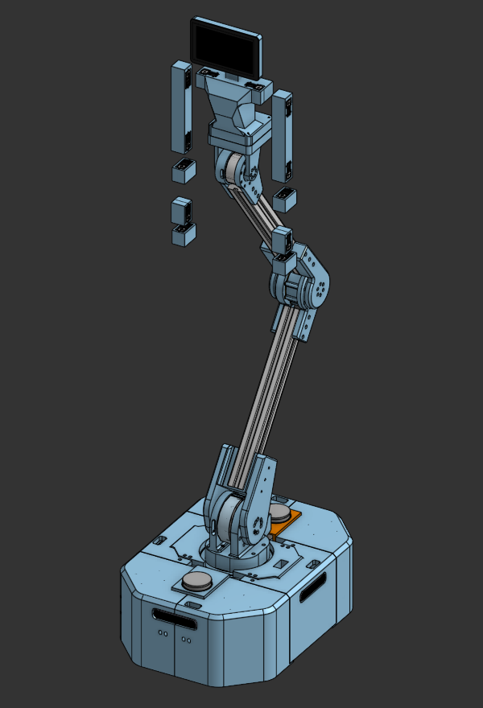

# Aizee / Minerva robotics platform

One Python package (`robot_platform`) and one root Cargo workspace serve two
robots: Aizee, a mobile manipulator, and Minerva, a dual-arm torso. Robot
definitions, deployment settings, and application adapters are selected
independently.

## Start here

Run these commands from the repository root in a Python 3.10+ environment:

```sh
python -m pip install -e ".[operator,simulation,dev]"
robot-platform list
robot-platform run collect --robot minerva --settings settings/examples/usb-tether.json --plan
robot-platform run collect --robot aizee --settings settings/examples/usb-tether.json --plan
```

`--plan` prints the resolved launch without starting the application or opening
hardware. Remove it to launch the selected collector. Use `python -m robot_platform`
if the console command is not on PATH. Applications still need this source
checkout; the shared libraries and profiles are packaged.

### Simulate without hardware

```sh
robot-platform sim run --robot minerva --output simulation_runs/minerva-001
# In another terminal, use that run's generated settings:
robot-platform run collect --robot minerva --settings simulation_runs/minerva-001/settings.json
```

Use `--robot aizee` in both commands for Aizee. Every run needs a new output
directory. Motors start disabled; simulation uses loopback endpoints and
suppresses physical leader/serial discovery. See the
[simulation guide](docs/architecture/SIMULATION_IMPLEMENTATION.md) for faults,
recording, trace reports, and current limitations.

The [guarded controller harness](docs/architecture/GUARDED_CONTROLLER.md) separately
tests the new Rust command ownership, expiry and stopping core through the shared
Python session. Build it with `./scripts/test_control_core.ps1` on the configured
Windows host, then run `python -m pytest tests/contract/test_guarded_controller.py -q`.
The Linux commissioning entry point now runs that core through SocketCAN and
acknowledged ZMQ. See [powered commissioning](docs/POWERED_COMMISSIONING.md) for
virtual-CAN results, all 14 motor watchdog passes, mandatory startup verification
and bounded gripper trials. General physical motion remains blocked pending commissioning.

### View and jog a robot model

```sh
python -m pip install -e ".[viewer,collision]"
robot-platform view --robot minerva
```

Open `http://127.0.0.1:8765`. The same viewer selects Aizee, Minerva or an
external URDF/model profile. It provides joint jogging, coupled jaws, pose
files and collision inspection without connecting to hardware. See the
[model tools guide](docs/MODEL_VIEWER.md) to add another robot.

Build the optional native collision library with
`./scripts/build_collision.ps1 -Test` on the configured Windows development
host, or `cargo build --locked --release -p robot_collision` on Linux.
**Conservative keep-out** checks enclosing arm boundaries without CAD refinement;
Minerva's four finger links are explicitly excluded in its model profile.
**Source CAD** and **Accelerated CAD** retain finger geometry. These viewer
checks do not drive or stop hardware. See the
[collision status and evidence](docs/architecture/COLLISION_RUNTIME_IMPLEMENTATION.md).

### View the GELLO leaders

For the dual GELLO inputs, run `./scripts/view_leaders.ps1` and open
`http://127.0.0.1:8767/`. The shared leader viewer provides live encoder positions,
schematic arms and software direction/reference controls. See
[dual GELLO setup](docs/GELLO_TELEOP.md) for virtual teleop testing and hardware gates.

### Train


```sh
python -m pip install -e ".[learning]"
robot-platform run train --robot minerva --plan
robot-platform run train --robot aizee --plan
```

Default data/output paths are `episodes/<robot>` and `checkpoints/<robot>`.
Select older datasets explicitly with `--set applications.train.data_dir=PATH`.
Old local checkpoints were removed during cleanup; train or supply a compatible
checkpoint before inference. No pretrained weights ship with the repository.
On Jetson, preserve the NVIDIA/JetPack-specific Torch installation.

## Repository map

```text
pyproject.toml                Python package, dependency extras, CLI, offline tests
Cargo.toml / Cargo.lock      Shared Rust workspace and locked dependencies
src/robot_platform/
  robots/                   Aizee / Minerva joint and camera definitions
  models/                   Mechanical model profiles, URDF metadata and assets
  viewer/                   Shared browser rendering, joint jogging, pose files
  settings/                 Packaged defaults and overlay validation
  control/                  Shared sessions, freshness, guarded commands, software stop
  transport/                MessagePack, ZMQ, discovery
  data/                     Recording formats, provenance, measurement traces
  simulation/               Synthetic plant, loopback server, fault scenarios
  characterization/         Protocol/config audit and bench-profile validation
  apps/                     Collection/training launch adapters
rust/                       comms, motor_control, lidar_control, robot_collision, robot_control
python/                     Active collector UIs, learning, devices, IK, tools
settings/examples/          Operator/machine overlays and bench-profile template
config/                     Hardware profiles, calibration, systemd/udev
firmware/                   Leaders, display, lift; required vendor BSP
urdf/aizee/                 Existing Aizee Onshape export and Git LFS meshes
urdf/minerva/               Composed 1.1 visuals / 1.2 collision CAD, profiles, audits, limits
scripts/                    Build, deploy, inventory, simulation validation
tests/                      Offline tests, fixtures, explicit hardware tools
docs/                       Current guides, plans, subsystem references
```

The [detailed map](docs/architecture/REPOSITORY_MAP.md) and
[configuration guide](config/README.md) explain ownership and remaining migration
boundaries. `python/` contains active application code and compatibility shims.

## Robots and deployment

| Robot | Active control | Controller profile | Command / telemetry |
|---|---|---|---|
| Aizee | Six arm joints, gripper, separate wheel drive | `config/hardware_jetson_rover.yaml` | `5555 / 5556` |
| Minerva left | Six arm joints and gripper | `config/hardware_minerva_left.yaml` | `5555 / 5556` |
| Minerva right | Six arm joints and gripper | `config/hardware_minerva_right.yaml` | `5575 / 5576` |

Minerva's head pan/tilt and lift are reserved, inactive slots in its 17-slot
recording/model schema. Wrist cameras use ports 5563/5565; scene/head uses 5564.
Shared settings select endpoints explicitly. Direct older tools may still use
network discovery. Aizee and Minerva motor services share ports and are alternate
deployments on a single host.

Build Rust services from the repository root on Linux/Jetson:

```sh
cargo build --locked --release -p motor_control -p lidar_control
```

Windows ARM64 cross-builds use `scripts/build_jetson.ps1`; see the
[build guide](rust/JETSON_CROSS_BUILD.md). Output stays under `rust/target`.
Manual controller launches require `AIZEE_CONFIG` set to the chosen profile.
Existing service units already set it.

The [Jetson setup guide](docs/quickstart/FRESH_JETSON_SETUP.md) distinguishes the
new development device from robot-service installation. Physical deployments
remain explicit operations.

## Validation and status

```sh
python -m pytest
python scripts/validate_simulation.py --output simulation_runs/validation-new
```

Default pytest discovery covers offline unit/contract tests. See
[tests/README.md](tests/README.md) for additional suites and hardware tooling.
The simulation baseline passed 248 Python tests and 12 live scenarios on
2026-09-17. ARM64 services cross-compile locally. The identified development
Jetson now builds and tests the native collision backend. Its 1,000-cycle
synthetic arm-to-arm keep-out replay completed at 25 Hz without deadline misses;
this is partial coverage with finger exclusions. Whole-robot motion, virtual
CAN, CAD dynamics and measured actuator calibration remain open. See the
[25 Hz acceptance plan](docs/architecture/COLLISION_25HZ_HARDWARE_PLAN.md),
[device log](docs/devices/JETSON_DEV_01.md) and
[September 21 checkpoint](docs/architecture/DEVELOPMENT_CHECKPOINT_2026-09-21.md).

## Documentation

- [Documentation index](docs/README.md)
- [Package installation and launch settings](docs/architecture/MONOREPO_IMPLEMENTATION.md)
- [Shared session integration](docs/architecture/SESSION_BACKEND_MIGRATION.md)
- [Simulation and physical validation plan](docs/architecture/SIMULATION_VALIDATION_PLAN.md)
- [Minerva bring-up](docs/MINERVA_BRINGUP.md)
- [Aizee learning pipeline](docs/LEARNING_PIPELINE.md)
- [Cleanup record](docs/architecture/REPOSITORY_CLEANUP.md)



[Aizee CAD in Onshape](https://cad.onshape.com/documents/191b8a861f2900918f30776f/w/8fcf08900b23701d0eff1c6a/e/fcb77dc7adbafb5b753006f3)
· [MIT license](LICENSE) · [LTRLAB](https://github.com/ltrlab)
