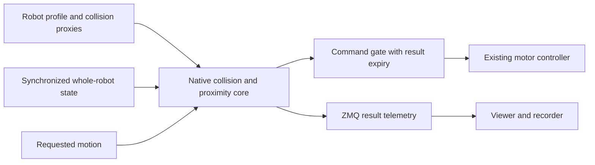

# Real-time collision checking: research and implementation direction

Research date: 2026-09-19 (America/New_York). This document records the initial
research and recommendations. Current code, validation and unfinished acceptance
work are documented in [implementation status](COLLISION_RUNTIME_IMPLEMENTATION.md).
In particular, coarse convex bounds now require source-CAD confirmation; their
overlaps are not physical collision verdicts.

## Decision

Keep FCL as the immediate baseline. It is an established standalone collision
library also used by MoveIt. Our current geometry and query lifecycle are the
first problems to fix; changing engines alone would leave those problems intact.
FCL supports collision, distance, broad-phase queries and continuous collision
queries without requiring ROS. [FCL](https://github.com/flexible-collision-library/fcl)

Build one robot-independent collision core for the shared platform, with a native
hot path and data-defined geometry, joints and contact policy. Keep ZMQ at process
boundaries. The viewer should consume the same core's results. Python remains
useful for importing, inspecting, calibrating and testing models.

Start with cached FCL objects and conservative runtime geometry. Benchmark that
baseline before selecting a different native engine. A Rust wrapper around FCL
preserves algorithm continuity; Parry is a plausible all-Rust alternative that
must pass the same correctness and latency tests. Neither choice requires the
full MoveIt or ROS stack.

## What our checker currently does

Relevant implementation:

- [CollisionScene](../../src/robot_platform/simulation/collision.py): loads meshes
  and builds their bounding-volume hierarchies once, calculates link transforms,
  filters candidate pairs with NumPy axis-aligned bounds, then calls FCL in a
  Python loop. It recreates collision objects at every pose.
- [Viewer server](../../src/robot_platform/viewer/server.py): caches the scene and
  serves collision queries over HTTP/JSON.
- [Viewer scheduling](../../src/robot_platform/viewer/static/collision-checks.js):
  adds a 150 ms debounce and coalesces changes while a query is running.

The full Minerva query currently uses 129 CAD collision meshes, **2,437,466
triangles**, and **7,681 candidate shape pairs** before broad-phase rejection.
It reports every intersecting shape pair for inspection. It does not calculate
distance to contact or enforce motion commands. Provisional interface labels do
not remove pairs from this strict query.

The browser's collision path does not use ZMQ. Geometry processing, repeated
object construction and UI scheduling explain substantial latency before any
change to the platform's messaging architecture is considered.

### Measurements on this development PC

Windows 11, Python 3.12.10, Intel64 Family 6 Model 170 Stepping 4. Input was the
current Minerva model, reference pose, the user's crossed-arm pose, and 18 seeded
random simultaneous configurations inside the candidate viewer ranges.

| Isolated experiment | Median | p95 | Maximum observed |
| --- | ---: | ---: | ---: |
| Existing full shape-pair query | 85.94 ms | 102.47 ms | 108.87 ms |
| Same query and geometry, persistent FCL objects | 36.82 ms | 48.24 ms | 54.59 ms |

The two variants ran interleaved, three repetitions of 20 poses. All **60 result
comparisons matched exactly**. Reuse improved median time about **2.33x**. This
experiment changes object lifecycle only; it does not change geometry, omit
contacts or deploy a runtime optimization.

A separate 20-pose profile attributed about 57% of total time to the object
construction wrapper. Forward kinematics alone had a 0.22 ms median. Initial
scene construction took 34.23 s and should remain outside operation.

These are sampled desktop timings, not Jetson measurements or deadline
guarantees. They exclude browser/network latency. The sample is too small to
establish rare tail behavior.

Local reproducibility artifacts are under the ignored
`simulation_runs/collision-research/` directory: `benchmark.py`, `benchmark.json`,
`profile.txt`, `reuse_experiment.py`, and `reuse_experiment.json`. Seed:
`20260920`. Source URDF SHA-256:
`10ed9f337563cce77eab3d14f624fcb0fa0631110193b920012c624bbfc2e6bc`.
The experimental reuse adapter relies on one geometry per shape and asserts that
condition; a production cache must instead key objects by instance and isolate
mutable transforms between concurrent workers.

## What MoveIt actually does

### Geometry and cached native queries

MoveIt recommends separate visual and collision meshes, with only a few thousand
collision triangles for the entire robot. Its self-collision matrix removes
selected pairs from checking; automated sampling can miss relevant poses, so
exclusions require review. [Model preparation](https://moveit.picknik.ai/main/doc/examples/urdf_srdf/urdf_srdf_tutorial.html)

The FCL integration caches base collision objects specifically to avoid expensive
local bounding-box reconstruction. It copies those cached objects, updates their
transforms and uses native dynamic AABB-tree managers to reject distant pairs.
This is a concrete optimization our current checker lacks. It does not imply
MoveIt performs no allocations. [MoveIt FCL source](https://raw.githubusercontent.com/moveit/moveit2/main/moveit_core/collision_detection_fcl/src/collision_env_fcl.cpp)

### Servo and proximity monitoring have separate rates

At the time of research, MoveIt 2 `main` defaults to a **100 Hz servo publish
rate** and a **10 Hz collision-check rate**. Both are configurable. Its default
self/world proximity thresholds are 1 cm / 2 cm; these are configuration defaults,
not validated margins for Minerva. A responsive servo does not imply every
collision query runs at the motor-loop frequency.
[Servo configuration](https://raw.githubusercontent.com/moveit/moveit2/main/moveit_ros/moveit_servo/config/servo_parameters.yaml)

The collision monitor runs in a separate thread, asks for self/world distances,
and provides a velocity scale to the servo. It slows motion near obstacles and
sets the scale to zero on collision. That separation is useful for our platform.
[Collision monitor source](https://raw.githubusercontent.com/moveit/moveit2/main/moveit_ros/moveit_servo/src/collision_monitor.cpp)

Library capabilities and integration capabilities differ: although FCL offers
continuous queries, MoveIt's inspected FCL two-state robot collision overload
reports that it is not implemented. MoveIt also offers a Bullet integration with
continuous checking. We must test the exact backend and motion interpolation we
choose. [MoveIt FCL source](https://raw.githubusercontent.com/moveit/moveit2/main/moveit_core/collision_detection_fcl/src/collision_env_fcl.cpp),
[Bullet integration](https://moveit.picknik.ai/main/doc/examples/bullet_collision_checker/bullet_collision_checker.html)

## Evidence from other working projects

These are concrete public implementations, not a claim that every industrial
controller uses the same backend or that another project's timings transfer here.

| Project / ecosystem | Verified approach | Relevance here |
| --- | --- | --- |
| Universal Robots | Official ROS/ROS2 drivers include MoveIt support. | Established vendor-supported integration. [Vendor documentation](https://www.universal-robots.com/developer/communication-protocol/ros-and-ros2-driver/) |
| Tesseract | ROS-independent C++ core with FCL/Bullet collision components. | Closest architectural example of retaining robotics capabilities with optional ROS adapters. [Project](https://github.com/tesseract-robotics/tesseract) |
| Coal, formerly HPP-FCL | Native collision/proximity library used in the Pinocchio and related robotics ecosystem; supports convex shapes, margins and distance queries. | Credible C++ alternative for proximity-heavy workloads. [Project](https://github.com/coal-library/coal) |
| OpenArmX | Public physical dual-arm bringup, CAN motor control and bimanual MoveIt configuration. | Community example with a hardware setup relevant to Minerva. [Project](https://github.com/openarmx/openarmx_ros2) |
| Mink | MuJoCo-based Python IK with collision-avoidance constraints and dual-arm examples. | Python orchestration can work when intensive calculations use optimized native code. [Project](https://github.com/kevinzakka/mink), [examples](https://kevinzakka.github.io/mink/tutorial/example_gallery.html) |
| Parry | Standalone Rust collision/proximity library. | Fits our Rust workspace; benchmark candidate, not evidence of dominant robotics adoption. [Project](https://parry.rs/) |

Tesseract exposes first-contact, closest-contact and detailed-contact modes, plus
discrete and swept checks. It provides both tree-based and simple pair managers;
simple loops can win for small scenes. We should benchmark query modes and pair
management on our actual model rather than assume a tree or an engine name is
automatically faster. [Collision architecture](https://tesseract-robotics.github.io/tesseract/collision.html)

GPU planning is a later option. cuRobo uses robot sphere approximations and
accelerated world queries. That is useful for batched trajectory search; it does
not establish the latency of a single Minerva check on an Orin Nano. A CPU
baseline should come first. [cuRobo geometry](https://curobo.org/get_started/2c_world_collision.html)

## Proposed shared-platform architecture

The core should be callable inside the control process, optionally on its own
bounded worker thread. The motor loop consumes a current, versioned verdict with
an expiry; it should never wait on the browser. ZMQ remains appropriate for
state distribution, diagnostics and other process boundaries.

### 1. Separate the geometry products

- **Visual model:** preserve the complete CAD and the viewer shading/detail fixes.
- **Audit model:** retain source-resolution geometry for inspection and comparison.
- **Runtime collision model:** use a small set of conservative boxes, capsules,
  cylinders and convex pieces, with explicit transforms and coverage margins.

Cover the physical body, tools and payloads. Preserve important spaces such as
gripper openings. A single convex hull around a whole articulated assembly can
fill useful gaps; arbitrary decimation can remove protrusions. Validate that the
runtime approximation encloses the intended physical surfaces, including thin
features. Full-resolution triangle intersection is a useful comparison, but can
miss complete containment and is not a complete solid-volume ground truth.

Store collision assets, geometry revision, joint mapping, mimic relationships and
contact policy in the robot profile. No fixed joint count, arm names or Minerva
branches in the generic engine. Rebuild caches on a model revision change.

### 2. Make queries fit their purpose

- Cache shapes, bounds and objects; update only instance transforms during motion.
- Execute pair filtering and collision/distance queries in native code. Benchmark
  persistent broad-phase managers against a compiled small-pair loop.
- For runtime, return collision status, nearest relevant separation, involved
  shapes, and a bounded set of near pairs. Reserve every-part-pair inspection for
  the viewer/audit mode.
- Include **both arms**, body, grippers, carried objects and configured obstacles
  in one coherent state. Independent arm limit ranges cannot guarantee that a
  combined pose is clear.
- Review intended mechanical contacts explicitly. Bind any approved exception to
  stable shape identities and a model revision. Current provisional overlaps are
  not automatic runtime permissions; never suppress all opposite-arm pairs.

### 3. Prevent contact before it happens

Use separation and predicted motion, not only current penetration. Calculate
slow/stop margins from relative closing speed, state age, computation/transport
latency, measured stopping distance, and geometry/encoder uncertainty. Both arms
can close the same gap simultaneously.

Validate the commanded motion over the stopping horizon. Clear endpoints do not
prove a clear path. Use conservatively bounded subdivisions and/or continuous
queries whose supported rotation/interpolation match the robot motion. For
example, Parry's ordinary `cast_shapes` handles linear translation without shape
rotation; that alone cannot validate a rotating arm.
[Parry shape-cast contract](https://docs.rs/parry3d-f64/latest/parry3d_f64/query/fn.cast_shapes.html)

Each result must identify the state sequence, state timestamps, model/world
revision, checked command/horizon, separation and completion time. The gate must
reject expired or mismatched verdicts and execute a defined, tested controlled
stop when checks or telemetry become unavailable. A cached "clear" boolean is
insufficient. These checks complement actuator limits and torque protection.

For ZMQ state streams, use complete snapshots with per-joint freshness and
bounded queues. Latest-value delivery must not discard other joints' updates.
`ZMQ_CONFLATE` retains only the latest message and does not support multipart
messages, so it cannot be enabled indiscriminately on existing streams.
[ZMQ socket options](https://libzmq.readthedocs.io/en/latest/zmq_setsockopt.html#zmq-conflate-keep-only-last-message)

### 4. Measure the complete operating path

Proposed first target: **100 Hz collision/proximity updates**, with p99 compute
time below 5 ms to leave room within a 10 ms period. This is an engineering target,
not a capability demonstrated by the current checker. Record maximum observed
latency, missed deadlines and end-to-end command age as well as percentiles.

Benchmark on the Orin Nano under sustained camera, recording and inference load,
including thermal steady state. Keep motor-loop timing independent. A measured
100 Hz average is not a hard real-time deadline guarantee; the expiry/stop path
must work even when a deadline is missed.

## Implementation sequence and acceptance checks

1. **Production object reuse:** cache per instance, isolate mutable state between
   concurrent requests, and invalidate on model reload. Preserve strict shape
   results across alternating poses, repeated mesh instances, mimic joints and
   concurrent viewer requests. The isolated experiment supports this step.
2. **Runtime geometry asset pipeline:** generate/review proxies, show them in the
   viewer, prove outward coverage and compare difficult poses against source CAD.
   Include crossed arms, thin protrusions, tight gripper spaces and containment.
3. **Native query benchmark:** use identical geometry, pair policy and workloads
   to test optimized FCL and, if needed, Parry or Coal. Include separated/near/
   penetrating configurations, distance queries and motion segments. Publish
   reproducible cases and warm/cold timing distributions. Select one runtime
   backend from correctness, latency and deployment evidence.
4. **Shared session command gate:** integrate synchronized state, braking-horizon
   checking, slowdown, expiry and controlled-stop handling. Exercise stale,
   missing, reordered and mismatched state before hardware operation. The viewer
   displays the same core's status while retaining detailed audit inspection.
5. **Jetson and physical validation:** replay recorded whole-robot states under
   load; then verify geometry clearances, encoder alignment, command latency and
   stopping response on hardware at controlled speeds. Raise operating speed
   only with measured margin and timing evidence.

The immediate implementation work is steps 1 and 2. The current source-CAD
inspection tool remains useful, but it should not become the motor command gate
without this runtime model, query and timing work.
