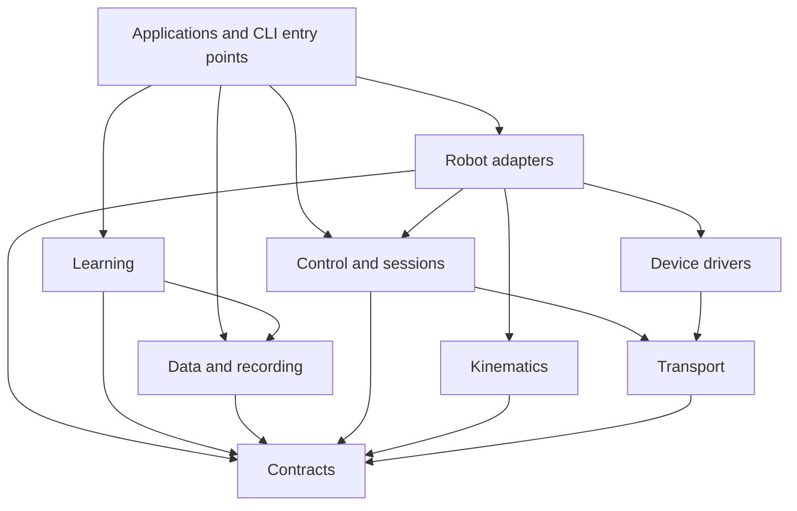

# Aizee / Minerva monorepo organization plan

Status: **migration in progress**, based on the [repository map](REPOSITORY_MAP.md). See the [implementation guide](MONOREPO_IMPLEMENTATION.md) for the completed package/workspace foundation and remaining integration work. The layout below is the eventual destination; legacy applications still have compatibility adapters.

## 1. Decision

Keep Aizee and Minerva in one repository with a shared platform layer. Start with **one installable Python distribution** and **one Cargo workspace**. Internal modules provide enough separation for the current scale; independently released Python packages would add version and installation coordination before there is a demonstrated need.

Use `robot_platform` as a provisional neutral Python namespace. The repository can remain named `aizee` during migration. Repository naming, service renaming and package extraction are separate decisions; the useful change is explicit ownership and dependency direction.

Two robot definitions should compose the same device/backend code. Aizee and Minerva may retain separate collector views and orchestration while the platform services underneath converge.

## 2. Proposed layout

Paths below are future destinations, not existing launch commands. `robots/` at the root contains declarative files/assets; `src/robot_platform/robots/` contains executable robot-specific adapters. No duplicate definitions: code loads the declarative specification.

```text
aizee/                              # repository name can stay
├── README.md                       # platform overview + choose a robot
├── pyproject.toml                  # installable Python package, extras, CLIs
├── Cargo.toml                      # one Rust workspace
├── Cargo.lock                      # reproducible application builds
├── src/robot_platform/
│   ├── contracts/                  # joint/camera specs, observations, capabilities
│   ├── transport/                  # MessagePack, ZMQ, discovery, latest samples
│   ├── devices/
│   │   ├── leaders/                # OpenRB, SO101, WebXR input protocols
│   │   ├── cameras/                # UVC and RealSense adapters
│   │   ├── power/                  # INA219
│   │   └── display/                # Tufty protocol
│   ├── control/                    # session, command lifetime, safety utilities
│   ├── kinematics/                 # parameterized URDF/IK/collision algorithms
│   ├── data/
│   │   ├── formats/                # Aizee v4/v5 and Minerva v6/v7 codecs
│   │   ├── recording/              # buffers, synchronization, finalization
│   │   └── replay/                 # reading, preflight, replay primitives
│   ├── learning/
│   │   ├── encoders/               # shared vision/state encoders
│   │   ├── policies/               # ACT, ACT-JEPA, Minerva flow composition
│   │   ├── objectives/             # flow matching, JEPA, SIGReg
│   │   ├── datasets/               # PyTorch views of episode formats
│   │   └── language/               # embedding cache and conditioning
│   ├── robots/
│   │   ├── aizee/                  # mappings, single-arm/base adapter, model hooks
│   │   └── minerva/                # mappings, dual-arm adapter, gravity model
│   └── apps/
│       ├── collect/
│       │   ├── shared/             # common UI widgets and view models
│       │   ├── aizee/              # Aizee workflow and views
│       │   └── minerva/            # Minerva workflow and views
│       ├── teleop/
│       ├── calibrate/
│       ├── train/
│       ├── policy/
│       ├── replay/
│       ├── bench/
│       ├── services/               # camera/power/display process entry points
│       ├── operations/             # heartbeat and setup applications
│       └── webxr/                  # server and packaged browser assets
├── crates/
│   ├── comms/
│   ├── motor_control/
│   ├── lidar_control/
├── robots/
│   ├── aizee/
│   │   ├── robot.yaml              # joint order, units, capabilities, camera roles
│   │   ├── profiles/               # rover/static, teleop and policy presets
│   │   ├── assets/                 # URDF + LFS meshes + provenance
│   │   └── calibration/examples/   # documented snapshots, not active state
│   └── minerva/
│       ├── robot.yaml
│       ├── profiles/               # arms-only initially; torso when integrated
│       ├── assets/                 # only when verified models exist
│       └── calibration/examples/
├── deploy/
│   ├── jetson/                     # bootstrap, deployment and recovery tools
│   ├── systemd/                    # templates + compatibility with current names
│   ├── udev/                       # templates driven by physical device identity
│   └── machines/                   # non-secret example overlays
├── firmware/                       # OpenRB, e-stop, Tufty, lift projects
├── third_party/openrb150_bsp/       # only move after resolving build references
├── tests/
│   ├── unit/
│   ├── contract/                   # wire, profiles, episodes, checkpoints
│   ├── integration/                # offline process/GUI/fake-transport checks
│   ├── hardware/                   # explicit opt-in, actual robot exercises
│   └── fixtures/
├── tools/                          # developer utilities such as repository map
├── docs/
│   ├── architecture/
│   ├── platform/
│   ├── robots/aizee/
│   ├── robots/minerva/
│   ├── operations/
│   └── research/
└── scripts/                        # temporary wrappers for old launch paths
```

Create destinations when a module is extracted. There is no need to scaffold all empty directories first. The inventory generator currently lives in `scripts/` and can move to `tools/` when developer tooling is reorganized.

## 3. Dependency rules



Arrows mean imports, not network traffic.

- Platform modules must not import applications or either robot's concrete definition.
- Robot adapters may import platform modules, but Aizee must not import Minerva and Minerva must not import Aizee.
- Applications select robot adapters explicitly. Sibling applications must not provide each other's private backend helpers.
- Data-format code must not require Qt, Torch, a leader connection or camera hardware. Torch dataset wrappers belong in `learning/datasets`.
- Device protocols must not hardcode the follower robot's joint vocabulary; mappings belong in robot adapters.
- Importing a module must not open devices, modify global scheduling/timers or create a GUI. Perform process setup at the application entry point.
- Rust/Python boundaries use versioned wire fixtures and documented behavior. Folder organization alone cannot enforce compatibility across languages.

## 4. Four contracts worth defining first

### RobotSpec: identity and capabilities

Define ordered joint names, units, control groups, camera roles, limits/default gains, available capabilities and a schema version. Explicitly distinguish joint position in radians, normalized gripper opening and lift distance in metres. Preserve the current representation until conversions are measured and validated.

Minerva's initial hardware profile has 14 active arm/gripper slots and three reserved slots in its 17-dimensional recording/model schema. Declare an active mask; absent hardware must not look like a live measurement. Keep backward-compatible zeros for existing recordings through a format adapter. Reject commands to unsupported capabilities at the session boundary rather than silently treating them as successful.

### RobotSession: one interface for teleop, replay and inference

Expose named/ordered observations, per-source timestamps and readiness, hold/idle/enable/disable behavior, target commands and shutdown. Aizee's implementation wraps its existing motor endpoint; Minerva's wraps the existing two endpoints. Keep optional drive control separate from arm policy actions.

Make command ownership and expiry explicit. Re-emitting a cached target is useful for motor keepalives, but it is not proof that the producer is alive. Specify maximum target age, reconnect behavior, source loss and shutdown order. Keep these as explicit reviewed behavioral changes when implementing the adapter; do not silently change them in a file-move patch.

### EpisodeSpec: preserve dataset meaning

Maintain separate versioned codecs for Aizee v4/v5 and Minerva v6/v7. Record robot identity, ordered joints/units, camera roles, sample rate, calibration/profile identity and action convention for future formats. Old formats retain explicit adapters and are not rewritten automatically.

Golden fixtures must verify next-command action alignment, timestamps, optional torque/command channels, missing-camera rules and half-open segment ranges. Checkpoints should carry enough matching metadata to refuse an incompatible robot/profile.

### DeploymentProfile: separate machine facts from robot facts

Robot profiles choose capabilities and topology. Machine overlays supply addresses, ports, USB identities, serial devices, installation root and calibration state paths. CLI overrides have highest precedence; active calibration applies to its identified device and should be validated against robot/machine identity. Emit a resolved config for debugging.

Current Aizee and Minerva services conflict on shared resources. Preserve mutually exclusive mode switching for the existing shared Jetson unless concurrent operation is explicitly configured with disjoint buses/ports/devices. A separate Jetson for each robot may reuse ports safely.

## 5. First extraction map

| Existing source | First destination / change | Why this is the boundary |
|---|---|---|
| `python/common/wire.py` | `transport/wire.py` | Both robots already use it; keep byte compatibility. |
| `_resolve_rover_host` in `collect_demo_app/config.py` | `transport/discovery.py` | Removes Minerva's private dependency on Aizee. Keep address ordering configurable. |
| Former `collect_demo_app/minerva_recording.py` | `data/formats/minerva.py` (implemented; unused shim removed) | Writer belongs to a data contract, not another collector. |
| `collect_demo_app/recording.py` | `data/formats/aizee.py` plus collection buffer code | Separate serialization from application state. |
| `common/arm_constants.py`, `common/minerva_constants.py` | Robot definitions plus extracted utilities | Remove the ambiguous `common` bucket. Avoid independently editable Python/YAML copies of the same defaults. |
| `collect_minerva_app/follower.py` | `robots/minerva/session.py` | Let policy, teleop and replay share actual dual-arm routing. |
| `collect_demo_app/zmq_io.py` | Aizee session + shared transport primitives | Preserve Aizee tracking/drive semantics while exposing a common interface. |
| `collect_*_app/images.py`, `receivers.py` | Shared acquisition primitives; retain app-specific wiring | Similar responsibilities with meaningful behavioral differences. |
| `act_model.py` encoder classes | `learning/encoders/` | Minerva and ACT-JEPA already reuse them. |
| `training/dataset.py`, `minerva_dataset.py` | `learning/datasets/` | Keep format-specific adapters, share normalization utilities only where semantics agree. |
| `nodes/gripper_camera_node.py` | `devices/cameras/uvc.py` + service CLI | One driver serves Aizee gripper and both Minerva wrists. |
| OpenRB/SO101 modules | `devices/leaders/` + robot-specific mapping | Shared hardware protocol and calibration operations, distinct follower semantics. |
| `tools/heartbeat_server.py` | Operations app + packaged web assets | Separate metrics/service adapters from HTTP/UI and remove hidden service-name selection. |
| Systemd/udev and deploy scripts | `deploy/` + machine overlay | Keep one source for device identity and installation paths. |

The file catalogue provides destination areas for every tracked file. It is a classification aid; mixed modules require splitting and are not suitable for bulk `git mv`.

## 6. Migration sequence and acceptance gates

Each stage should be a reviewable change. Preserve old entry points with thin wrappers until deployments and operator workflows have migrated. Keep behavior changes separate from relocations.

### Stage 0 — establish the baseline

- Keep this map and inventory in the repo; identify current operator commands and deployed service/config versions for each robot.
- Enumerate offline checks separately from commands that enable or move hardware.
- Capture representative wire frames, tiny versioned episodes and relevant profile fixtures. Use existing synthetic fixtures where sufficient.
- Record the existing test results and environment limitations; do not call a source-only review a passing baseline.

**Gate:** both robot paths have documented entry points, dependencies and offline regression commands. Hardware testing is a separate, explicitly selected activity.

### Stage 1 — package and extract the first shared utilities

- Add `pyproject.toml` and the `src/robot_platform` namespace.
- Extract wire helpers, host discovery and versioned episode writers. Update both collectors to use them, retaining compatibility shims at old imports.
- Replace path surgery in migrated modules with package imports. Resolve profiles/assets through explicit paths or packaged resources, not repository-parent arithmetic.
- Install data-only, operator, Jetson and learning roles separately. Keep Qt/WebRTC/GPU/RealSense dependencies optional and test each supported environment.

**Gate:** wire fixture bytes and HDF5 round trips match; original launch wrappers work from outside the repo directory after installation; the data/transport package imports without optional GUI/ML/hardware libraries.

### Stage 2 — establish robot specs and shared sessions

- Separate joint vocabulary/mapping/gains from utility code; give declarative robot profiles a single canonical loader.
- Wrap the current Aizee and Minerva transports behind the same session contract.
- Adapt Minerva policy telemetry/command routing to the dual-arm session as a distinct integration change.
- Preserve the existing Rust wire protocol and process topology at this stage.

**Gate:** simulated left/right telemetry maps to the correct indices; commands reach only the intended endpoint; source expiry, missing arms, hold/idle and shutdown have explicit assertions. Unsupported head/lift capability is visible. No real hardware is needed for these contract checks.

### Stage 3 — extract acquisition and organize applications

- Move collector loops, GUI views, teleop and replay into application packages.
- Consolidate receiver lifecycles, frame caches, synchronization, recording finalization and reusable widgets through tested interfaces.
- Separate process initialization from import-time side effects in modules such as `collect_demo_app/runtime.py`.
- Keep the two collector UIs and differing state machines until shared contracts support a deliberate convergence.

**Gate:** both collectors complete offline record/save/reload cycles; readiness and camera requirements stay robot-specific; offscreen GUI and thread-shutdown checks pass.

### Stage 4 — organize learning and deployment

- Extract algorithm-neutral encoders, objectives, dataset utilities and training CLI entry points.
- Preserve checkpoint state-dict keys where possible; when renaming model attributes, provide an explicit checkpoint migration/loader mapping.
- Render/validate service and device configurations from machine profiles; preserve existing service names during transition.
- Move robot assets and calibration examples with explicit lookup compatibility. Do not overwrite active calibration with example snapshots.

**Gate:** old episodes and checkpoints still load; synthetic forward/backward/inference checks pass; deployment plans resolve paths/ports/services for both modes without applying changes to a robot. Validate packaged web/URDF resources, not just source-checkout paths.

### Stage 5 — move Rust/firmware support, retire compatibility paths

- Move the Cargo workspace to root and crates under `crates/`; update deployment/build references and track the application lockfile.
- Split the motor executable into config, lifecycle, command handling and scheduling modules without changing its public wire contract.
- Consider generic control-group config only in a separate behavior/schema change, with old-profile translation.
- Isolate vendor board support after checking PlatformIO references, custom patches and license/provenance. Update `.gitattributes` for moved LFS assets and LF-sensitive scripts/service files.
- Remove legacy wrappers and superseded helpers only after checking imports, tests, docs, service files and deployed callers.

**Gate:** Linux Rust build and protocol tests pass; firmware builds find the correct board package; deployment artifacts reference no retired paths. Bench validation of preserved motion, stop and recovery behavior precedes updating the live installation.

## 7. Validation structure

| Test tier | Existing seeds | Intended coverage |
|---|---|---|
| Unit | `test_actuator_char`, segmentation/settings checks | Pure codecs, math, labeling and config validation |
| Contract | HDF5 tests, wire fixtures, profile fixtures | Python/Rust serialization, joint ordering/units, schema compatibility |
| Offline integration | Minerva collector/model/shutdown smoke tests, ACT pipeline tests | Fake publishers, recording, GUI lifetime, training and inference plumbing |
| Hardware | Current CAN exercises and motor integration scripts | Physical calibration, motor response, camera devices and recovery |

Split overloaded test files as needed. Some existing tests call older full-vector Minerva sender helpers, so their success alone would not prove the live dual-arm adapter works. Test actual routing explicitly.

Keep hardware tests out of default discovery. Run the offline matrix on Windows for operator code, Linux for Rust/Jetson-facing code, and an appropriate Torch environment for learning. Lock dependencies per role/platform, including Jetson-specific GPU wheels, rather than assuming one lockfile can serve every machine.

## 8. What completion looks like

- Both collectors use the same transport/acquisition/data libraries; neither imports the other's internals.
- Robot differences are expressed in explicit specs and adapters, including active capabilities and units.
- A backend change can be validated against both robots in one offline suite.
- Teleop, replay and policy inference use the same session contract for a selected robot.
- Operator, device-service and training installs have clear dependency boundaries.
- Config paths, USB identities, calibration state and service selection have explicit owners.
- Episodes, firmware and deployed launch commands survive the migration or have documented compatibility paths. Old local checkpoints were explicitly removed in the 2026-09-18 cleanup; new outputs remain ignored.

**Recommended first implementation slice:** Stage 1's packaging plus wire, discovery and episode-writer extraction. It removes real cross-application dependencies immediately and establishes the pattern for the rest of the monorepo.
