# Robotics Platform Consolidation Implementation Plan

Implementation update, 2026-10-16: I1 is integrated through receiver ramp fix
`6b47de8` and calibrated simulation `d7a1610`; accepted delivery baseline `610c66b`
passes 801 Python and 132 Rust tests with zero required skips. Public Windows/Linux
CI is running. The original SHA inventory and proposed commands below remain the
planning snapshot. See [the implementation record](../development/PLATFORM_INTEGRATION_20261016.md).
The operator selected right-wrist + fixed-neck D435 head RGB for initial capture;
both arms and grippers remain required (14 axes). A left-wrist camera is optional
for a future explicitly declared camera roster.

**Review date:** 2026-10-16  
**Status:** Proposed implementation roadmap, based on inspected source and recorded evidence. No branch integration, hardware operation or implementation is performed by this document.  
**Product decision:** Minerva's first hardware milestone includes **both arms and both grippers**, with 14 active axes and whole-robot policy/human authority.

## 1. Outcome and project assessment

Build one robotics platform that runs this repeatable loop:

**Collect → validate → freeze a dataset → train → evaluate → qualify and deploy → infer on the robot → accept human correction → validate and retrain → simulate and collect simulated/real data → evaluate → deploy or reject → repeat.**

The repository has substantial reusable implementations: robot specifications, configuration layers, collection applications, learning models, a guarded Rust receiver, teleoperation lifecycle, collision envelopes, simulation adapters and immutable software releases. It does **not yet have one qualified end-to-end learning and correction loop**. The largest remaining work is joining these implementations through explicit contracts and proving that the same semantics survive recording, training, inference and operator intervention.

The first deliverable is a repeatable **real-data bimanual loop**. The complete platform deliverable adds task-capable simulation, mixed real/simulation datasets and a repeatable second-robot integration path. Simulation physics work starts early in parallel; missing physical measurements must not prevent proving the real-data loop.

Head/lift actuation, navigation, new learning architectures, separate microservices and a repository-wide directory rename are outside the first delivery. The head camera may still be an observation input. Preserve the existing ACT, ACT-JEPA and Minerva flow/JEPA models while consolidating their interfaces.

### What to retain and what to connect

| Area | Already implemented | Consolidation gap / decision |
|---|---|---|
| Platform foundation | Installable Python package, one Cargo workspace, RobotSpec, settings/profile layering, application launcher | Keep these. Remove checkout-dependent resource loading and prove installation outside the repository. |
| Control | Rust ownership/lease/sequence checks, freshness, limits, stopping, CAN adapter; Python lifecycle and collision envelopes | Make this the single supported motor path for collection, inference and correction. Do not build another controller. |
| Runtime applications | Helm guarded/direct sessions; collector and policy session adapters | Collectors/inference still include legacy motor-control paths. Extract a shared runtime owner from Helm and migrate callers. |
| Recording | Aizee v4/v5 and Minerva v6/v7 HDF5, TraceWriter, bounded Helm RecordingWriter, task/segment information | Unify identity, clock mapping, command provenance, cameras and interventions; stream durable episodes instead of buffering decoded images. |
| Learning | ACT/ACT-JEPA; Minerva language-conditioned flow policy, JEPA and EMA | Shared sample/policy contracts, actual-model CI, finite missing-channel handling, reproducible resume, deployment-equivalent evaluation. |
| Simulation | Protocol simulator, ArmPlant, receiver harness, MuJoCo adapter, kinematic model, fitted actuator parameters | Distinguish capabilities. Fix calibration lineage before using fits as learning evidence; add measured coupled/contact/camera task simulation. |
| Operations | Verified software release manifests, activation/smoke/rollback, local strict control gate and CI configuration | Publish integration, obtain remote gate results, extend releases to model bundles and add persistent learning jobs. |
| Hardware | Extensive stopped checks, tuning, firmware/watchdog and failure-recovery evidence | Latest logs still record timing deviations and right-side hardware problems. Bimanual autonomy needs its own complete-workload qualification. |

## 2. Source snapshot and branch integration order

These are the reviewed inputs, not an assumption that branch names will remain at these commits.

| Ref | Full reviewed SHA | Relationship |
|---|---|---|
| Current checkout: `overhaul` | `a66afa774f8dd8e8982cb28d3cb4c131fa6b114d` | Dirty original checkout; preserve it |
| `codex/overhaul-integration` | `f846b65a945f612a94f60081d1905caa4b32029e` | Existing accepted integration checkpoint |
| `claude/teleop-fault-fixes` | `7c767c823872f0e55de312f2b4be60add0be9a80` | 78 commits ahead of integration |
| `claude/sim-calibrated-params` | `d7a1610b5203c82c83a23fe7e5acd8566b0a0e6a` | 90 commits ahead of integration |
| `claude/sim2real` | `8a84b0ee1dec906b285f9c61af81f30807cc0079` | Ancestor of calibrated parameters; do not merge separately |

The 37 inspected local branches reduce to **two maximal tips**: fault fixes and calibrated simulation. Their common ancestor is `34d42e95914706ce41faf958710d9a8500c5e181`; they contain 12 and 24 exclusive commits respectively. Both sides changed `scripts/dev.py` and `src/robot_platform/helm/teleop.py`. These are semantic review hotspots, not a prediction that Git must report conflicts.

The 11 modified tracked files in the original checkout match `codex/dev-baseline`. Do not copy them into integration again. Preserve `outputs/`, `result.json` and required ignored recordings/build evidence separately. GitHub currently exposes only `main` at `db444060cf3e71e817aabf4c8899976b5fbe53f8` and `minerva` at `8a2634b0e1800c1ac7c1ef364c32ccaaf6ff5a6d`; both reported unprotected. Local implementation is substantially ahead of the published repository.

### I1 — Integrate the two tips in sequence

**Priority P0 · Owner: integration lead · Dependencies: none · Proposed branch: `codex/integration-20261016`.**

1. Freeze the SHAs above; inventory dirty/untracked/ignored evidence, active operator launch paths, running processes and deployed source. Verify the proposed branch and worktree names are unused.
2. Create an isolated candidate from the pinned integration checkpoint. Fast-forward the candidate to the fault-fix tip. Keep the existing integration checkpoint unchanged until offline integration qualification passes.
3. Run the strict gate on the fault-fix checkpoint and archive its complete report.
4. Merge the calibrated simulation tip **once**. Preserve both sets of developer checks, current silence/recovery semantics, simulation selection and recording hooks.
5. Commit the resolved candidate; run gates on that frozen source. Only then fast-forward the accepted integration branch.

Planned commands, **not executed by this plan**:

```powershell
git worktree add -b codex/integration-20261016 C:/Users/ltr/Workspace/aizee-integration-20261016 f846b65a945f612a94f60081d1905caa4b32029e
git -C C:/Users/ltr/Workspace/aizee-integration-20261016 merge --ff-only 7c767c823872f0e55de312f2b4be60add0be9a80
# Run the checkpoint gate before the next merge.
git -C C:/Users/ltr/Workspace/aizee-integration-20261016 merge --no-ff --no-commit d7a1610b5203c82c83a23fe7e5acd8566b0a0e6a
```

Existing gate commands, run from the candidate worktree using its own environment:

```powershell
python scripts/dev.py setup
./scripts/build_jetson.ps1 -Offline -Package robot_control,robot_collision
python scripts/dev.py check
```

Use CPython 3.12, Rust 1.98.1 and hydrated LFS assets. The offline cross-build assumes provisioned pinned tools/caches; provision through the existing bootstrap flow when absent. Build source-matching ARM64 artifacts where release checks require them. Share download caches only, never editable installations, native outputs, ports or recording directories.

**Acceptance:** Both checkpoints have frozen-source reports with no required skips/xfails. The merged gate retains browser checks and response-fitting/simulation checks. Integrated regression coverage includes quiet-gripper recovery, refusal to set aside a quiet arm joint, Helm loss, feedback timestamp ordering, two-arm simulation engage/follow/shutdown, fitted-parameter identity/fallback, and exclusion of simulation parameters from robot releases. Report actual test totals; do not add branch totals together.

### I2 — Publish and establish the delivery baseline

**Priority P0 · Owner: integration lead · Dependencies: I1 · Branch: `codex/platform-delivery-baseline`.**

Publish the accepted integration line and run Windows/Linux CI there. Refresh `docs/DEVELOPMENT_STATUS.md` and `docs/development/NEXT_TASKS.md` to distinguish accepted source, deployed source and qualified modes. Add named required checks and branch protection as repository administration work. Use the existing task handoff template for subsequent changes.

Repair a concrete clean-CI prerequisite: the current workflow runs setup/check without building ARM64 release binaries; `test_ops_release.py` skips without them, while the strict developer gate rejects skips. Add pinned, source-matching ARM64 provisioning/builds to CI and explicit Linux support; `scripts/build_jetson.ps1` is Windows-only. If native control and ARM64 release checks become separate jobs, both remain mandatory with an aggregate pass requirement. Do not turn missing release artifacts into a permitted skip.

**Acceptance:** Clean Windows/Linux runners reproduce the documented required gates, including release verification with matching ARM64 artifacts; remote reports name the accepted commit and binary hashes. Status links the latest deployment and its unresolved deviations. Each task has one owner, base SHA, owned files, reproducer, gate and dependency list. Retire an old branch/worktree only after ancestry, unique files, ignored evidence, launcher/process dependencies and remote backup are checked; cleanup is a separate action.

### Current hardware evidence is a separate gate

The latest fault log at `7c767c8:docs/development/TELEOP_FAULTS_20261015.md` records release **`20261016T003435Z-95a9903`**, receiver hash prefix `81b685a3`, and a 740-test gate with zero failures/skips/xfails. Its private-vcan both-arm feed-forward trial had **1 miss in 13,011 updates, maximum 12.63 ms**. Both-arm position-only and left-arm feed-forward trials had zero misses. Similar stalls occurred in 4 of 13 post-recorder runs; disconnecting the live view did not eliminate them.

That is **deployed with recorded timing deviations**, not qualification for every mode. The same log records right J5 and a nonresponding right gripper as unresolved hardware items. This is the latest inspected record, not a live hardware diagnosis. Quiet-gripper lowering is a recovery feature; it does not make a missing gripper eligible for bimanual collection or inference.

This roadmap supersedes the historical direct-teleop-only priority and any one-arm-first product milestone. Individual component diagnostics may still be necessary, but they do not satisfy the first hardware milestone.

## 3. Target architecture and invariants

Keep one Python distribution and one Cargo workspace. Add small shared boundaries around existing implementations before moving their internals.

```mermaid
flowchart LR
    UI["Helm / CLI / collection app"] --> RT["Shared runtime owner and source arbiter"]
    HUM["Both human leaders"] --> RT
    OBS["Timestamped robot and camera observations"] --> POL["Policy worker"]
    POL --> RT
    RT --> LIFE["Existing lifecycle and motion envelopes"]
    LIFE --> RX["Guarded Rust receiver"]
    RX --> PLANT["Robot or simulator"]
    PLANT --> OBS
    RT --> REC["Bounded episode recorder"]
    OBS --> REC
    RX --> REC
    REC --> VAL["Validate and curate"]
    VAL --> DS["Immutable dataset version"]
    DS --> TRAIN["Train"]
    TRAIN --> EVAL["Evaluate and qualify"]
    EVAL --> REG["Versioned policy and runtime release"]
    REG --> POL
```



| Boundary | Existing implementation to retain | Intended ownership |
|---|---|---|
| Contracts and robot definition | `contracts.py`, `robots/`, settings/profile files | Named units, joints, camera roles, capabilities and versioned observation/action/episode/policy schemas |
| Runtime composition | Helm session/teleop composition, control clients, teleop lifecycle | Proposed `robot_platform.runtime`: profile resolution, session owner, arbiter, chunk executor and injected transports |
| Motion enforcement | `control/`, `teleop/`, `rust/control_core`, controller service | Receiver owns final authority, freshness, limits and stopping; one owner changes Python/Rust contracts together |
| Data | `data/formats`, `data/traces`, Helm recording | Canonical episode adapters, streaming recorder, validator, dataset manifests |
| Learning | Existing `python/training` and policy nodes | Proposed shared reader and policy adapters; gradual migration into `robot_platform.learning` |
| Simulation | `simulation/`, `characterization/response_fit.py` | Capability-declared plants, calibration provenance, synthetic episode production |
| Operations | `ops/release.py`, deploy/smoke/rollback | Software/model bundles, persistent artifact/job registry, release selection |
| Applications | Helm, launcher, collectors, train/policy scripts | Thin composition and operator workflow; no independent motor authority |

Dependency direction is **applications → runtime → control/lifecycle → receiver**. Runtime must not import Helm or operational command modules. Inject SSH/transport construction at the application boundary. Keep forwarding imports during extraction; do not convert `contracts.py` into a package or move all firmware/Cargo directories merely to match an aspirational tree.

The essential invariants are:

1. **One physical receiver owner.** Policy, leaders and replay submit proposals to one runtime. The runtime holds the lease; sources never obtain separate motor publishers.
2. **Whole-robot authority.** Both arms and grippers change source together. No mixed human/policy ownership by arm in the first release.
3. **Freshness survives every layer.** Keep original sensor time, clock mapping, observation cutoff, plan identity and action validity. Resending a chunk must not make its observation appear new.
4. **Correction invalidates policy work.** At the runtime's takeover-request event, increment authority generation, discard both-arm chunks and reject late inference results before the next policy dispatch. Separately record the receiver-acknowledged hold barrier: already-sent commands have a bounded in-flight interval, and none may affect motion after that verified barrier. Local generations alone do not fence the receiver.
5. **Human release means hold.** Policy resumes only after explicit intent, a post-correction observation and a new valid plan. Reconnect/restart never silently resumes.
6. **No hidden control work.** Inference, training, camera decoding, compression and disk writes are outside the control loop with bounded queues and explicit overload behavior.
7. **Artifacts are immutable.** Episodes, dataset snapshots, models, evaluations and deployments have hashes and lineage. Training and evaluation do not mutate the active model.
8. **Evidence is scoped.** Receiver acceptance is not proof of physical motion; synthetic timing is not hardware qualification; action prediction loss is not task success.

## 4. Prioritized implementation backlog

P0 blocks integration or the first bimanual hardware milestone. P1 is required for a repeatable learning platform. P2 completes the simulation-augmented loop. Tasks with a P0 minimum and P1 extension deliver their milestone-critical contract, real-data training/evaluation and release slice first; expanded reproducibility and operations follow. These are dependency priorities, not permission to omit P1/P2 from the final goal.

### C1 — Freeze the bimanual task and shared contracts

**P0 · Owner: platform lead with control/ML/operator input · Dependencies: I1 · Branch: `codex/bimanual-platform-contracts`.**

Choose one bounded task that requires both arms and both grippers. Proposed default: one arm presents a lightweight object and the other grasps it and places it in a marked tray. Freeze geometry, object/tooling coverage, workspace, reset procedure, task labels, success conditions, trial variations and intervention definition before measuring policy improvement. Define allowed object/gripper contact, forbidden inter-arm contact, held-object attachment changes and geometry uncertainty explicitly; existing arm-envelope coverage alone does not establish safe handover contact.

Specify the 14 active named axes against the complete Minerva robot catalog, camera roles and units. Define observation, action proposal, policy bundle and intervention event contracts jointly with D1. The legacy 17-slot representation remains an import format; inactive head/lift placeholders are not new learned action outputs.

**Acceptance:** A versioned task spec and fixtures cover valid/invalid axis orders, units, cameras, authority changes and allowed/forbidden contact. Primary success means unassisted task completion within the frozen trial window; assisted completion and recovery are separate outcomes. Success/intervention metrics and paired evaluation procedure are fixed. Observation age, inference completion age, action horizon, command validity and clock uncertainty are separate fields. Every unspecified deployment budget has a named measurement and must be resolved in R4 before hardware acceptance.

### H1 — Restore and measure bimanual hardware readiness

**P0 · Owner: hardware/control lead · Dependencies: none for evidence triage; I1 before candidate qualification · Branch: `codex/bimanual-readiness`.**

Recheck the right J5 fault and right gripper communication failure; preserve identity, firmware, power/CAN and fault evidence. Reproduce the recorded timing outlier with a discriminating trace under both-arm position-only and feed-forward workloads. Include recorder/UI and then the proposed policy/camera workload. Select the supported control law explicitly; do not claim an unqualified optional law passes.

**Acceptance:** All 14 required axes answer and meet the commissioned reference/range/feedback checks. No set-aside joint qualifies as healthy. Fixes have a before/after reproducer and unchanged stopping/freshness requirements. Archive every trial, including failures. Hardware readiness and release scope identify any excluded mode; a clean rerun does not erase an unexplained stall.

### R1 — Extract shared runtime composition without behavior change

**P0 · Owner: control/runtime lead · Dependencies: I1, C1 · Branch: `codex/shared-runtime`.**

Extract profile/timing validation and session construction from Helm into a headless runtime. Retain TeleopLifecycle, DirectLifecycleSession, GuardedLifecycleSession, codecs, envelope compiler and Rust control law. Inject clock, receiver transport, leader source, model/compiler and recorder. Remove the dependency cycle in which operational code reaches through Helm for runtime construction.

**Acceptance:** Existing deterministic traces retain requests, transitions, targets, deadlines and faults. Strict gate passes. A headless client constructs/closes the same session without UI or ops imports. No wire-format, gain, collision-mode or motion-law changes are bundled into extraction.

### R2 — Implement authority arbitration and cancellable policy execution

**P0 · Owner: control/runtime lead · Dependencies: R1, C1 · Branch: `codex/whole-robot-authority`.**

Add disabled/hold/policy/human/fault source modes above the existing lifecycle. Require full named-joint proposals with source sequence, authority generation, observation reference, original timestamp, intended execution time and expiry. Keep one receiver lease. Put policy inference in a bounded worker and action-chunk scheduling in the runtime owner.

**Acceptance:** State-machine tests reject partial rosters, duplicate/reordered/expired actions and old-generation results. A takeover racing inference completion cannot dispatch the old result. Define two observable events: runtime takeover request (no further policy dispatch) and receiver-acknowledged whole-robot hold (no earlier policy command may subsequently affect motion). Bound and trace any command already in flight between those events. Prove the existing sequence/lifecycle protocol establishes that barrier; if it cannot, add a versioned receiver fence under the same Python/Rust contract owner before hardware trials. After the barrier, align/engage both leaders using measured pose and readiness checks. Missing one leader/arm prevents human following for the whole robot. Stop/fault/restart cancels all work; late worker results cannot renew authority. Preserve appropriate gripper holding behavior during stopping.

### D1 — Define a canonical episode and legacy adapters

**P0 · Owner: data lead · Dependencies: C1 · Branch: `codex/canonical-episodes`.**

Use a distinct schema namespace such as `platform_episode/1`, separate from legacy numeric HDF5 versions. Preserve asynchronous raw receiver/camera/event streams and generate a versioned causal training view. Include episode/session/task/source IDs, robot/model/calibration/profile/software hashes, named axes, units, validity masks, camera payloads and capture times, clock identities/mappings/uncertainty, policy ID and shared authority generation.

Record **requested, selected, receiver-accepted and receiver-emitted** commands separately where available, plus measured feedback. Do not call emitted commands motor-applied acknowledgements. Persist interventions, rejected plans, faults, resets, task outcome and real/simulation origin.

**Acceptance:** Round-trip fixtures retain identity and time semantics. v4/v5 and v6/v7 readers preserve original bytes/hashes and mark absent provenance unknown. Unknown metadata is not invented or silently accepted into promotion-eligible datasets. Every action chunk ends before an authority/reset/fault/task boundary, gap or episode end; masking cannot bridge a takeover. JEPA future-image targets must remain within the same valid task/authority segment as their current observation and supervised actions.

### D2 — Stream durable bimanual episodes

**P0 · Owner: data lead · Dependencies: R1, D1; use C1 event contract · Branch: `codex/streaming-collection`.**

Connect receiver events, both-arm state and the selected three camera streams to one bounded disk-owning worker. Reuse compressed camera payloads and existing recorder queue/error handling. Append chunks rather than storing an entire session of decoded RGB frames. Use UUID episode names, partial files and atomic completed-manifest publication on the same filesystem.

**Acceptance:** A 30-minute representative recording stays within a configured, measured memory bound with zero silent drops. Short successive recordings never collide. Disk slowdown/full/error, queue overflow, camera loss and abrupt termination leave an explicit incomplete/quarantined episode, never a training-visible completed manifest. Recorder faults reach the operator and the defined whole-robot hold/stop policy without blocking the control thread. Duplicate finalization is harmless; recovery is explicit and checksummed.

### D3 — Validate, curate and version datasets

**P0 minimum validation/split slice; P1 expanded curation · Owner: data lead · Dependencies: D1, D2 · Branch: `codex/dataset-validation`.**

Produce machine-readable quality reports, eligible windows and immutable manifests. Validate finite required channels, units/order, clocks, sensor age/skew, camera decoding, completeness, causal observation cutoffs and action-label alignment. Use receiver-emitted reference targets for the declared following action interval; retain requested expert actions separately. Define observation-state `qcmd` as the last receiver-emitted reference available at the observation cutoff, identically in training and inference, rather than the previous policy prediction. Do not shift retained rows blindly after dropped samples.

Preserve torque missingness in raw data. Initially filter torque-incomplete windows for torque-conditioned modes; position-only modes may retain them. Compute normalization from valid training channels only. Human corrections require confirmed takeover for both arms, transition exclusion windows and review; autonomous output is not automatically expert supervision.

**Acceptance:** Fixed fixtures catch NaN normalization, future observations, joint reorder, gaps and authority-crossing action chunks or JEPA targets. Future images are permitted as training-only targets within the same valid segment, never as current observations. A clamped/rejected-proposal fixture proves reader/runtime `qcmd` parity. The same manifest reproduces the same sample inventory. Split groups bind sessions and derived/correction/synthetic parent lineage together. Test data is excluded from training, normalization and simulator calibration. Reusing a benchmark failure for training requires explicitly retiring/replacing its test partition. Real, simulation and correction sampling weights are recorded.

### L1 — Consolidate policy adapters and reproducible training

**P0 compatible real-data training/adapter slice; P1 full resume tooling · Owner: learning lead · Dependencies: D1, D3; fixture work starts after D1 · Branch: `codex/reproducible-policy-training`.**

Add minimal EpisodeReader and PolicyAdapter contracts around existing algorithms. Keep ACT and ACT-JEPA adapters and Minerva's flow/JEPA/language/EMA design. Map Minerva's 14 named outputs to the receiver's active roster; inactive catalog slots are metadata. Reject incomplete action vectors.

Fix evaluation-time camera dropout, finite channel handling and raw-versus-EMA evaluation mismatch. Checkpoint architecture, cameras, preprocessing, units/order, normalization, language-cache identity, dataset/split hashes, optimizer/scheduler/EMA/scaler, RNGs, loader generator and epoch. Support reproducible epoch-boundary resume first; changing the dataset creates a new fine-tune run.

**Acceptance:** Required CPU CI instantiates the real small Minerva model without pretrained downloads, executes multiple batches, backpropagates, updates EMA, saves/reloads, denormalizes and maps actions. Outputs/losses are finite. Seeded uninterrupted/resumed runs agree within declared tolerances. Zero-batch/nonfinite runs fail without registering a valid model. Strict checkpoint loading rejects unexpected incompatibility; any training-head stripping uses an explicit allowlist. Add this evidence to required learning checks; existing control tests do not substitute for it.

### L2 — Evaluate the exact deployable policy

**P0 deployment-equivalent evaluation slice; P1 extended automation · Owner: learning lead · Dependencies: L1, D3, C1 · Branch: `codex/policy-evaluation`.**

Use the same PolicyAdapter preprocessing, normalization, camera order, EMA weights and flow sampling configuration as inference. Report held-out per-joint physical-unit errors, real/sim and normal/correction strata, seeds, task results where available, inference latency distributions, deadline misses, stale-input rejection, clamps, faults and interventions.

**Acceptance:** Evaluation is reproducible from a frozen dataset/checkpoint manifest. Incompatible robot/camera/action/normalization identities fail before command generation. Training losses and teacher-forced errors are labelled as such, separate from closed-loop task success. CPU smoke and periodic actual-configuration GPU tests cover the Minerva policy, not only a fake adapter. No candidate is promoted solely for lower prediction loss.

### R3 — Join collection, inference and operator correction

**P0 · Owner: runtime lead with data/learning adapters · Dependencies: R2, D1, D2, L1 · Branch: `codex/guarded-learning-loop`.**

Migrate supported collection and Minerva inference into the shared runtime. Add operator controls for policy start, whole-robot takeover, correction outcome and explicit resume. Surface authority, observation age, policy identity, recorder state and rejection reasons. Do not route the new physical path through the currently unsupported physical GuardedSessionClient shortcut; compose the already implemented lifecycle/receiver path deliberately.

**Acceptance:** A headless scenario records an episode, loads a produced compatible model, runs policy, takes over both arms, records correction, resumes from a new observation and reloads the episode with intact lineage. Slow/crashed inference, stale camera and recorder pressure cannot block takeover or keep policy alive. New supported callers do not start legacy competing publishers. Enforce a common device-ownership boundary for supported old/new launchers: attempting each legacy live launcher while the shared runtime owns the device must fail before emitting enable/motion frames, demonstrated against isolated virtual CAN. Receiver lease exclusivity alone does not exclude a legacy publisher using another controller path.

### O1 — Extend release verification to model bundles

**P0 bundle/preflight/rollback slice; P1 expanded release automation · Owner: operations/integration lead · Dependencies: R3, L2 · Branch: `codex/policy-release-bundles`.**

Extend existing release manifests and atomic activation/rollback. Bind software, model checksum/adapter, task, robot/calibration compatibility, preprocessing/language cache, normalization, dataset/split, evaluation and runtime budgets. This task delivers tooling using explicitly unqualified candidate profiles. R4 measurements freeze the actual profile before creating the immutable candidate bundle for qualification. Qualification reports reference that bundle hash externally; they do not mutate its manifest. Preflight before activation; switch only at a stopped session boundary.

**Acceptance:** Wrong robot, missing camera, changed calibration, corrupt checkpoint or incompatible runtime is refused. Staged activation/shadow checks produce a complete record. Rollback selects a previous compatible software-plus-model bundle and starts a fresh safe session. Neither trainer completion nor copying a checkpoint mutates live policy. The qualified model remains fixed throughout each episode.

### R4 — Qualify the first bimanual hardware milestone

**P0 · Owner: control lead and designated hardware operator · Dependencies: phase R4a needs H1, R2, D2, C1; phase R4b needs R4a, R3, L2, O1 · Branch: `codex/bimanual-loop-qualification`.**

This is one bimanual milestone with two explicit phases, so policy training does not depend on demonstrations that can only be collected after policy qualification:

1. **R4a — Attended bimanual demonstration collection.** Qualify the manual collection profile and software release through the evidence ladder, then collect genuine task demonstrations with both arms and grippers. Run D3 validation, L1 real-data training and L2 evaluation. CPU-fixture models qualify software only and are not substituted for this policy.
2. **R4b — Bimanual policy and correction.** Measure the complete policy/camera/recording workload, freeze its profile, use O1 tooling to create an immutable candidate bundle, then qualify that exact bundle through the evidence ladder and attended policy/correction trials. A changed source, model, calibration or profile invalidates affected qualification evidence. The resulting generation A is reused in E1.

Reuse the existing bimanual motion-envelope path; validate inter-arm, tool and relevant object geometry and stopping behavior. Add or constrain missing held-object/contact coverage according to C1, including attachment transitions and uncertainty margins. Current collision-disabled direct teleop is regression evidence, not qualification for overlapping bimanual autonomy.

Follow deterministic contracts → native receiver/plant → Linux vcan → loaded Jetson timing → attended hardware. Include cameras, policy inference, both leaders, recording, UI and release serialization in the final workload.

**Acceptance:** Both arms and grippers participate from the first hardware collection phase. All 14 active axes are healthy. Enforced inter-arm protection, permitted task contact, coordinated stopping, takeover and explicit fresh-observation resume pass. No unsafe/expired action is accepted, no action from the superseded policy generation is dispatched after the takeover request, and no superseded in-flight action affects motion after the acknowledged hold barrier. Normal-workload trials meet the frozen cadence/deadline budgets. Fault injections produce bounded lifecycle recovery with no automatic policy restart. R4a does not authorize autonomous operation; the full milestone closes only after R4b. Failure of one arm is not a partial milestone pass. If collision compute exceeds budget, optimize or explicitly redesign and requalify the profile; do not disable protection or relax assertions to obtain a pass.

### O2 — Run durable validation/training/evaluation jobs

**P1 · Owner: platform/operations lead · Dependencies: D3, L1, L2; O1 for deployment records · Branch: `codex/learning-job-runner`.**

Start with one local CLI, SQLite artifact/job registry and subprocess workers, with an optional remote training worker adapter. Extend the existing platform launcher rather than introduce a separate orchestration product. Track immutable inputs/outputs, idempotency key, state, heartbeat, logs, retry reason and exit code.

Episode completion can trigger validation; reviewed data triggers a frozen snapshot according to a configured minimum batch/correction policy. Training success triggers evaluation and registers a candidate. Promotion remains a separate release decision; initial physical promotion has a human owner.

**Acceptance:** Worker death, host restart, duplicate notifications, cancellation and retry do not create duplicate valid models or lose lineage. Resume uses checkpointed state; stale job claims are reconciled. A 24-hour offline soak completes repeated batches and a deliberate crash/restart. Resource limits keep training away from control-critical CPUs/memory. “Always running” means persistent pipeline availability; robot collection occurs only within an enabled, supervised session and supported operating envelope.

### S1 — Repair simulation provenance and validate actuator fits

**P0 before simulation-derived learning claims · Owner: simulation lead · Dependencies: I1 · Branch: `codex/simulation-lineage`.**

Retain fitted actuator models, including the documented gripper fallback. Bind each fit to the actual preview mapping, gravity terms/scale, servo UID/firmware, source recordings and fitting algorithm. The inspected fitting bindings do not fully identify the actual mapping, and exporting an old fit with current gravity settings can mislabel its lineage.

Split independent recording sessions before filtering/fitting; full-recording zero-phase filtering must not contaminate holdouts. Report conditional trajectory replay separately from free rollout, since measured other-joint trajectories are stronger inputs than a deployed simulator receives.

**Acceptance:** Changing mapping, UID/firmware or gravity terms invalidates the fit or requires an explicit new version. Old artifacts cannot be silently rebound. Independent day/session/gain holdouts report residuals, uncertainty and failure cases. Required empirical evidence is a named gate, not a skipped optional test. Simulation parameters remain excluded from robot actuator configuration/releases.

### S2 — Add task-capable Minerva simulation and episode export

**P2 · Owner: simulation lead with hardware measurements · Dependencies: S1, D1, D2, R3; validated physical inputs · Branch: `codex/minerva-task-simulation`.**

Use the MuJoCo/receiver adapter already present. Replace placeholder physical properties with measured or independently justified masses/inertias/transmissions; validate coupled motion, contact/grasp behavior and rendered task cameras. Add a seeded task-environment contract with reset, termination and success/failure outcomes, plus a named action source: teleoperated expert, scripted task expert or explicitly reviewed policy trajectories. Add bounded randomized scenarios with seed/provenance and output through the canonical episode path. A rendered autonomous rollout is not automatically approved behavior-cloning supervision.

Declare capabilities per simulator: protocol-only, kinematic, independent-actuator dynamics, coupled dynamics, contacts and rendered cameras. Do not count black/synthetic transport images or kinematic motion as visual manipulation simulation.

**Acceptance:** Invalid/placeholder physics blocks a dynamics-qualified label. Independent holdouts check coupled response and the task's grasp/contact behavior; thresholds and uncertainty are frozen before the holdout. Real and simulated adapters obey the same axis/unit/action/episode contracts. Every synthetic episode pins model, actuator-fit, renderer, scenario, seed, action-source identity and reviewed training eligibility. Expert-generated fixtures demonstrate successful task supervision; candidate rollouts retain their separate status. An unattended bounded simulation batch completes or quarantines failures without altering robot configuration. Model measurement completion is a real external dependency, not assumed implementation progress.

### P1 — Prove installation and robot portability

**P1 · Owner: platform lead · Dependencies: R1, D1, R3 · Branch: `codex/platform-portability`.**

Package Helm/static resources and explicit robot bundles; replace checkout-root assumptions with package resources or configured external assets. Adapt Aizee to the shared runtime/data/policy interfaces. Add a small external fake/sim robot with a different joint count and camera order.

**Acceptance:** A clean wheel install outside the checkout launches the supported UI/CLI and runs collect → validate → policy adapter → human correction on the external fixture without modifying core code or hardcoding its name. An offline Aizee session also uses the shared runtime, its own action/camera mapping, canonical episode path and correction semantics. Explicitly declare Aizee's initial arm-only control scope and reject drive requests through an adapter that lacks base actuation; its advertised drive capability must not silently imply support from an arm-joint action vector. Minerva and Aizee legacy readers remain compatible. No editable install, source-tree working directory or Minerva-sized action assumption is required. Retire legacy motor publishers only after parity and replacement runbooks are demonstrated.

### E1 — Demonstrate two real-robot learning generations

**P1 · Owner: platform lead with operator and ML lead · Dependencies: R4, D3, L2, O1, O2 · Branch: `codex/bimanual-two-generation-demo`.**

Reuse the approved demonstrations and trained/evaluated/qualified generation A from R4a/R4b. Execute the bimanual task, intervene, retain the shared authority/correction events, review correction windows and create dataset B. Train generation B and compare under the unchanged benchmark protocol. Include a deliberately failing candidate to exercise rejection.

**Acceptance:** One report traverses episodes → validation → dataset/split → job → checkpoint → evaluation → runtime release → policy episode → correction → next dataset and model. The second generation is actually trained on approved new corrections. Promotion or rejection preserves the qualified release; explicit rollback is demonstrated. See Section 7 for separate platform-operation and learning-improvement criteria.

### E2 — Complete the real-plus-simulation repeat loop

**P2 · Owner: platform/ML/simulation leads · Dependencies: E1, S2, P1 · Branch: `codex/sim-real-learning-loop`.**

Freeze mixed datasets from qualified simulated episodes, new robot episodes and reviewed corrections. Compare real-only and mixed-data candidates on the same untouched real benchmark; hold the real subset, architecture/preprocessing, optimizer-step or compute budget and evaluation protocol constant. Record sampling weights, ablations and multiple training seeds where feasible. Run at least two consecutive pipeline iterations with a restart between them.

**Acceptance:** Each iteration produces traceable validation, training, evaluation and promotion/rejection decisions. Simulated parentage cannot leak across splits. Real performance is reported separately and must satisfy the frozen promotion rule; an aggregate sim score cannot hide real regression. The job runner resumes without duplicate releases. The complete platform documentation explains task setup, collection, intervention, curation, simulation, evaluation, promotion and recovery.

## 5. Delivery sequence and staffing

Use one integrator and one owner for motion contracts. Roles can be held by the same person; do not count them as assumed staffing. Three parallel implementation lanes are useful after C1: control/runtime, data/learning, and simulation/operations. Hardware measurements require reserved operator/device time.

| Wave | Work that can proceed | Exit / integration rule |
|---|---|---|
| 0 — Recover the current work | I1 then I2; H1 evidence triage in parallel | Two tips consolidated on a frozen, reproducible integration commit |
| 1 — Freeze shared boundaries | C1, then R1 and D1; S1 and physical measurement inventory in parallel | Reviewed contracts and headless runtime; no competing ownership changes |
| 2 — Build the offline loop | R2; D2 → D3 → L1 → L2 using fixtures; then R3 | Real model can enter the guarded runtime, be interrupted and produce valid correction data in offline tests; this does not qualify that fixture model for hardware |
| 3 — First hardware milestone | R4a after H1/R2/D2; real-data D3/L1/L2; then O1/R4b. P1 and O2 in parallel | **Both arms and grippers** collect genuine demonstrations, then complete trained-policy inference/correction under the frozen profile |
| 4 — Repeat learning | E1 after O2 and qualified hardware | Two real-data generations, failed-candidate rejection, rollback and complete lineage |
| 5 — Simulation augmentation | S2 can develop as inputs arrive; then E2 | Repeated real-plus-simulation training with independent real evaluation and portability proof |

The likely critical path is **I1/I2 → C1 → R1/R2 plus D1/D2 → R4a → real-data D3/L1/L2 → R3/O1 → R4b plus O2 → E1**; R3 and learning software can develop earlier with fixtures. O1 requires both R3 and L2; E1 requires both completed R4 and O2. H1 hardware repair and R4 collision/timing qualification can dominate elapsed time. S2's physical measurements dominate the simulation completion path. No responsible completion date can be inferred from commit counts or passing unit tests; estimate these paths after I1/H1/C1 establish reproducible baselines.

Merge one accepted task at a time, rerun affected required gates, and update remaining task bases. R1/R2 own the Helm/runtime extraction and cross-language motion boundary; data/ML work starts against reviewed contracts rather than editing those same files concurrently. A passing software branch may integrate while a hardware milestone remains explicitly blocked.

## 6. Timing, data and qualification gates

### Preserve existing budgets; measure the new policy profile

| Reviewed existing setting | Value | Interpretation |
|---|---|---|
| Geometric teleop loop | 20 ms / 50 Hz | Candidate basis for bimanual qualification |
| Envelope computation / verdict lifetime / reaction reserve | 12 ms / 80 ms / 10 ms | Explicit geometry contract, not an unlimited background check |
| Receiver tick / maximum lateness | 2.5 ms / 10 ms | Receiver timing must be measured independently of host loop averages |
| Feedback timeout / lease | 30 ms / 150 ms | Existing receiver-profile constraints |
| Helm geometric dispatch deadline | 35 ms | Different from the 20 ms nominal period; report both cadence and deadlines |
| Leader target age / source skew | 50 ms / 20 ms | Human-source settings, not automatically vision-policy budgets |
| Direct teleop loop / command validity / velocity timeout | 100 Hz / 30 ms / 15 ms | Collision-disabled regression profile |
| Legacy Minerva policy | 20 Hz, 200 ms stale threshold, 16 executed steps | Nominal 800 ms chunk; never relabel all steps as newly observed |

C1/R4 must define a policy-specific maximum observation age, camera age/skew, inference deadline, executed horizon, replan condition and takeover-to-hold bound. Measure them on the actual device with the chosen policy. A fresh receiver command cannot compensate for an expired observation or action horizon. Record all quantities in the release profile.

For data-view development, proposed pilot targets are 20 Hz, clock-mapping uncertainty ≤5 ms, inter-arm observation skew ≤25 ms and image age ≤100 ms. These are **new acceptance proposals**, not measured existing performance or authorization to relax motion bounds. C1 must adopt or revise them explicitly before admitting promotion-eligible data.

### Required evidence ladder

| Gate | Minimum pass evidence |
|---|---|
| G0 — Contracts | Deterministic source arbitration/cancellation, clocks, invalid schemas, chunk boundaries, legacy adapters, strict model compatibility |
| G1 — Software | Frozen-source Python/Rust gate, Windows/Linux CI, actual-model CPU training/reload/resume, package-install smoke |
| G2 — Native simulation and Linux vcan | Actual receiver path, both arms, complete rosters, faults/restarts/late results, disabled final state and reproducible traces |
| G3 — Loaded Jetson | Intended cameras/inference/leaders/recorder/UI; p50/p95/p99/max, misses/skipped slots, observation ages, envelope costs and takeover latency |
| G4 — Attended bimanual hardware | Healthy 14-axis roster, task geometry/limits, coordinated stop, real correction/resume, repeatable bounded task trials |
| G5 — Learning and orchestration | Two real generations, immutable lineage, rejection/rollback, crash/restart and 24-hour offline job soak |
| G6 — Complete platform | Independently qualified task simulation, real/sim split integrity, repeated mixed-data iterations and external-robot fixture |

Initial G3 test design: three independent 125-second normal-workload trials plus one 30-minute representative soak, on the exact release/profile; archive all attempts. Zero normal-workload violations of the frozen timing/freshness contract are required. Injected-fault runs are judged on expected bounded stop/recovery, not zero faults. These finite runs establish scoped pilot qualification, not an indefinite-runtime guarantee.

G4 uses both arms from the first product milestone. Tests may begin with component diagnostics and offline fixtures, but a successful single-arm test cannot close G4. Hardware operation remains within the existing designated-operator workflow.

### Failure matrix

| Injected condition | Required outcome |
|---|---|
| Human takeover races with inference completion | Runtime generation changes before further dispatch; old result rejected; already-sent work is bounded and fenced before acknowledged hold; request/hold/human-engage events recorded |
| Late chunk, duplicate/reordered packet or old observation | Rejected without extending authority/freshness |
| One leader or required arm feedback disappears | Whole-robot lifecycle hold/stop/fault; no partial policy/manual continuation |
| Quiet gripper during recovery | Existing scoped recovery behavior remains; session cannot requalify as healthy collection/inference |
| Receiver restart, lease loss or uncertain acknowledgement | Invalidate all source generations; explicit recovery and new session required |
| Inference worker hangs/crashes | Control remains responsive; expired work cannot keep motion alive |
| Camera stale/missing or wrong order | Policy observations rejected according to the frozen contract; recorder marks invalidity |
| Disk full/blocked writer/queue overflow | Nonblocking fault notification; incomplete episode quarantined; configured hold/stop response |
| Process dies during finalization | No completed manifest for partial payload; explicit recovery/checksum process |
| Wrong model/normalizer/calibration/robot | Preflight refusal before command generation |
| Trainer dies or duplicate job arrives | Recoverable job state and idempotent artifact registration |
| Candidate regresses or fails qualification | No promotion; qualified bundle preserved and rejection evidence retained |

## 7. Definition of done for the learning loop

The platform is not complete when one script runs or a training loss decreases.

**Operational loop acceptance:** E1 must demonstrate two distinct trained model generations from genuine bimanual robot episodes, with actual human corrections in generation B's approved data, an untouched benchmark, traceable deployment, deliberate failed-candidate rejection and rollback. Rejection of B is a correct platform behavior; it does not prove learning improvement.

**Learning-improvement acceptance:** Freeze a pilot benchmark in C1. Proposed starting design is 30 paired trials per candidate across predefined task variations, with randomized order and the same reset procedure. Primary success is unassisted completion within the trial window; report assisted completion separately, along with intervention frequency/duration, completion time, faults and uncertainty. A proposed initial task target is ≥90% unassisted success; generation B should maintain success and achieve either ≥10 percentage-point success gain or ≥25% fewer interventions at comparable completion time. If A is near the success ceiling, choose the intervention/time criterion before evaluating B. These are pilot targets to ratify in C1, not claims of achieved reliability; report confidence intervals and do not declare superiority from an inconclusive sample.

Any safety-envelope violation fails the relevant qualification. Stops, faults and operator rescues remain in the denominator and report even when the object eventually reaches its destination. A model may be rejected despite better average task metrics.

**Complete requested loop:** E2 adds qualified simulated data and new real episodes, validates both, trains a mixed-data candidate, evaluates on protected real trials, records promotion/rejection and repeats after a process restart. The persistent job service handles the offline work continuously; live collection and inference retain explicit session ownership and operator controls.

## 8. First execution backlog and project controls

The next executable work is:

1. **I1:** freeze/preserve evidence, create the candidate worktree, qualify fault fixes, merge calibrated simulation, qualify the merge.
2. **I2:** repair clean-CI ARM64 prerequisites, publish integration, run mandatory remote gates and refresh current status.
3. **H1:** reverify the two right-side hardware issues and reproduce the dual-arm timing outlier; reserve operator time in parallel with integration.
4. **C1:** choose the bimanual task and freeze the observation/action/episode/policy boundaries.
5. **R1 + D1:** extract shared composition and implement schema fixtures in parallel under those contracts.
6. **S1:** repair fitted-parameter identity before building training/evaluation claims on calibrated simulation.

For every task, use the existing handoff template: base SHA, scope/owned files, hypothesis, reproducer, acceptance command, evidence, uncertainty and dependencies. Record source acceptance and hardware qualification separately. A task is done only when its evidence is reproducible, its caller has migrated, its failure behavior is covered and its operator/developer documentation is updated.

The main project risks and responses are:

| Risk | Delivery response |
|---|---|
| Local branch drift and stale status documents | Freeze inputs, integrate once, publish CI and keep one accepted source checkpoint |
| Unhealthy right-side drives or unexplained timing stalls | H1 runs in parallel immediately; no bimanual milestone waiver |
| Geometry checking exceeds Jetson budget | Measure complete workload; optimize existing backend or redesign/version the profile with fresh evidence |
| Camera/telemetry misalignment or missing torque contaminates training | Raw clocks plus causal view, executable validator, explicit masks and train-only normalization |
| Policy cancellation appears correct but stale actions still execute | Race tests at dispatch/receiver boundaries, authority generations and traced acknowledgements |
| Simulation looks plausible with invalid physical inputs | Capability labels, measured inputs, independent holdouts and provenance checks |
| Team spends effort on restructuring instead of a usable loop | Keep distribution/workspace and algorithms; merge small contract-driven slices with milestone evidence |

## 9. Evidence map

The plan distinguishes inspected implementation from proposed tasks. Source citations use `<reviewed ref>:<repository path>` because this document may be read from the older original checkout.

| Reviewed source | Supports |
|---|---|
| `7c767c8:AGENTS.md`, `7c767c8:docs/DEVELOPMENT.md`, `7c767c8:docs/development/TASK_TEMPLATE.md` | Worktree isolation, one contract owner/integrator, strict gate and evidence ladder |
| `7c767c8:docs/development/TELEOP_FAULTS_20261015.md`, `7c767c8:docs/DEVELOPMENT_STATUS.md` | Latest fault/deployment record and stale status contrast |
| `7c767c8:src/robot_platform/helm/teleop.py`, `7c767c8:src/robot_platform/helm/settings.py`, `7c767c8:src/robot_platform/teleop/guarded_lifecycle.py`, `7c767c8:src/robot_platform/control/session.py` | Runtime composition, both-arm envelope selection, existing lifecycle and session limitations |
| `7c767c8:config/devices/minerva-teleop.json`, `7c767c8:config/devices/minerva-teleop-direct.json`, `7c767c8:config/minerva.yaml` | Timing settings and legacy policy horizon |
| `7c767c8:src/robot_platform/contracts.py`, `7c767c8:src/robot_platform/robots/definitions/`, `7c767c8:src/robot_platform/control/guarded_transport.py`, `7c767c8:rust/control_core/` | Robot identity, guarded transport and receiver enforcement |
| `7c767c8:python/scripts/collect_demo_app/`, `7c767c8:python/scripts/collect_minerva_app/`, `7c767c8:src/robot_platform/data/`, `7c767c8:src/robot_platform/helm/recording.py` | Existing collection, formats, trace and bounded recorder implementations |
| `7c767c8:python/training/train_minerva.py`, `7c767c8:python/nodes/minerva_policy_node.py`, `7c767c8:python/scripts/evaluate_policy.py`, `7c767c8:tests/ml/` | Learning/evaluation consolidation and coverage gaps |
| `d7a1610:src/robot_platform/characterization/sim2real.py`, `d7a1610:src/robot_platform/characterization/response_fit.py`, `d7a1610:config/devices/simulation/minerva-production-01-actuators.json`, `d7a1610:tests/evidence/test_sim2real_20261015.py`, `d7a1610:src/robot_platform/simulation/` | Fitted parameters, mapping/gravity lineage defect, simulation capability and empirical evidence |
| `7c767c8:src/robot_platform/ops/release.py`, `7c767c8:src/robot_platform/ops/deploy.py`, `7c767c8:tests/unit/test_ops_release.py`, `7c767c8:scripts/dev.py`, `7c767c8:scripts/build_jetson.ps1`, `7c767c8:pyproject.toml`, `7c767c8:.github/workflows/offline-control.yml` | Existing release/package foundation and missing clean-CI cross-build prerequisite |

Related architecture: [monorepo plan](MONOREPO_PLAN.md), [implemented package](MONOREPO_IMPLEMENTATION.md), [session migration](SESSION_BACKEND_MIGRATION.md), [guarded controller](GUARDED_CONTROLLER.md), [simulation validation](SIMULATION_VALIDATION_PLAN.md). Those documents remain useful subsystem references; this plan defines the current cross-platform delivery sequence.

