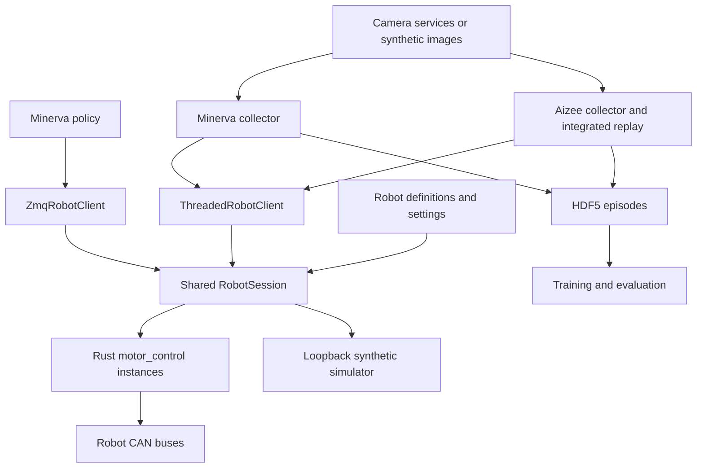

# Aizee / Minerva repository map

Updated 2026-09-18 after the shared-package migration and repository cleanup.
The [generated inventory](REPOSITORY_INVENTORY.md) enumerates tracked files;
the [implementation guide](MONOREPO_IMPLEMENTATION.md) explains installation.

## Runtime



The same Rust motor binary serves Aizee's bus or either Minerva arm. Minerva
uses one process per arm. Motor commands are MessagePack over ZMQ PUSH/PULL;
telemetry is MessagePack PUB/SUB; cameras use multipart headers and image bytes.
The current simulator substitutes a synthetic server for the controller/motor
path. It does not yet execute the Rust controller or load CAD geometry.

| Deployment | CAN bus | Command / telemetry | Cameras |
|---|---|---|---|
| Aizee | `can1` | `5555 / 5556` | Gripper 5563, optional scene 5564 |
| Minerva left | `canL` | `5555 / 5556` | Left wrist 5563 |
| Minerva right | `canR` | `5575 / 5576` | Right wrist 5565 |
| Minerva head/scene | — | — | 5564 |
| Simulation | None | Allocated loopback ports | Allocated loopback ports |

Generated simulation settings contain the actual bound ports. Aizee and
Minerva physical services share ports, so deployment on one host selects one
robot. Head/lift slots are inactive and have no shared-session command routes.

## Source ownership

| Location | Responsibility |
|---|---|
| `pyproject.toml` | One Python distribution, extras, CLI, default test selection |
| `Cargo.toml`, `Cargo.lock`, `.cargo/` | One three-crate Rust workspace; output under `rust/target` |
| `src/robot_platform/robots/` | Canonical robot joint order, groups, camera roles, capabilities |
| `src/robot_platform/settings/` | Defaults, layered JSON overrides, endpoint/config validation |
| `src/robot_platform/control/` | Routing, observations, source freshness, command leases, socket lifecycle, e-stop fanout |
| `src/robot_platform/transport/` | Shared wire envelopes and discovery |
| `src/robot_platform/data/` | Aizee/Minerva HDF5 writers, synthetic provenance, event traces |
| `src/robot_platform/apps/` | Validated collection/training launch plans and compatibility execution |
| `src/robot_platform/simulation/` | Seeded synthetic joint model, loopback server, cameras, scenarios |
| `src/robot_platform/characterization/` | Manual/protocol audit and verified bench-profile requirements |
| `rust/comms/` | Shared wire schemas and ZMQ primitives |
| `rust/motor_control/` | ROBSTRIDE codec, CAN lifecycle, controller/watchdog, raw trace hooks |
| `rust/lidar_control/` | Optional LiDAR service |
| `python/scripts/collect_*` | Active collector loops, robot-specific UI/workflows, calibration adapters |
| `python/common/` | Compatibility imports plus robot-specific gains/helpers still being migrated |
| `python/control/`, `python/ik/` | Gravity fitting/models, Aizee URDF/IK/collision tools |
| `python/teleop/`, `python/web/` | Leader drivers, standalone teleop, Quest/WebXR interface |
| `python/training/` | ACT/JEPA/flow models, datasets, training, inference, analysis |
| `python/nodes/`, `python/tools/` | Camera/power/display services, policy nodes, host dashboard/checks |
| `python/scripts/actuator_char/` | Bench acquisition and analysis behind the characterization CLI |
| `settings/examples/`, `config/` | Operator overlays, hardware profiles, calibration, service definitions |
| `scripts/` | Build, deploy, maintenance, inventory and live validation runners |
| `firmware/` | Embedded projects; OpenRB vendor BSP is required by its build |
| `urdf/aizee/` | Existing CAD export, meshes and source metadata; no Minerva model yet |
| `tests/`, `python/tests/` | Offline unit/contract tests and optional GUI/ML checks |

## What has been consolidated

- Both collectors and Minerva inference use the shared session backend.
- Legacy `common.wire` forwards to the package. HDF5 writers and discovery are
  shared; Minerva no longer depends on Aizee's writer or private discovery helper.
- Unused pre-session telemetry receivers and Minerva command/telemetry helpers
  were removed. Their coverage lives in the session and live-process suites.
- The unused PyO3 placeholder was removed; ZMQ remains the Python/Rust boundary.
- Python extras replace the old workstation/training requirements files.
  `requirements_jetson.txt` retains device-specific installation constraints.

## Remaining boundaries

1. Standalone Aizee inference/replay and selected diagnostic tools still own
   their older transports. Their existence as CLIs does not imply dead code.
2. Collector UI, acquisition, learning and device modules still require a
   checkout. Move these only after separating their assets and import contracts.
3. Gains, calibration, camera sizing and GUI preferences remain split between
   application code and config files. See [config ownership](../../config/README.md).
4. The production-controller simulation tier, measured actuator profiles and
   coupled CAD model remain planned work. See [validation plan](SIMULATION_VALIDATION_PLAN.md).

## Local artifacts

`episodes/`, `checkpoints/`, `simulation_runs/`, `calibration_runs/`, `phase0_runs/`, `logs/`, `viz/`, `dist/` and
build caches are ignored runtime outputs. The old checkpoints and their plots
were removed on request; recorded episodes and simulation evidence remain.
New training/analysis runs recreate their output directories.

Regenerate the inventory after staging additions/removals:

```sh
python scripts/repo_inventory.py
```

It uses tracked working-tree paths and static Python import candidates, including
the `src/` package root. It does not prove runtime reachability or resolve
dynamic imports, shell/config references, or physical deployment state.
