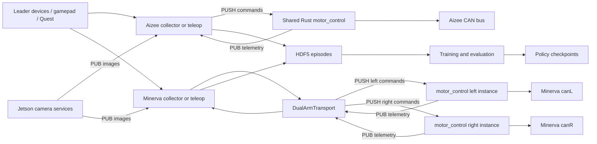

# Aizee / Minerva repository map

This repository contains a shared robot platform and two robot applications, but its directory structure still reads like a single Aizee application. The existing Rust backend is already reused. The largest organizational problem is that Python libraries, application internals, robot definitions, and machine configuration share overlapping responsibilities.

**Recommendation:** keep one monorepo, one Rust workspace, and initially one installable Python package with explicit internal boundaries. Give Aizee and Minerva separate robot definitions and profiles. Extract common infrastructure from both applications into the platform.

## Reading this map

This is the pre-migration baseline. See the [implemented monorepo guide](MONOREPO_IMPLEMENTATION.md) for subsequent package/workspace changes.

- [Proposed layout and migration sequence](MONOREPO_PLAN.md)
- [Complete grouped file inventory](REPOSITORY_INVENTORY.md)
- [Machine-readable inventory and Python import edges](repository_inventory.json)
- [Inventory generator](../../scripts/repo_inventory.py)

Reviewed on 2026-09-15 against `overhaul` at `8a2634b`. Findings come from tracked source, configs, service files, and deployment scripts. Runtime behavior on the robot and test success were not verified for this map. Labels such as “shared candidate” describe a proposed responsibility, not proof that a file is already robot-independent.

## 1. Scale and shape

The baseline has **698 tracked files**, including **230 vendored OpenRB board-support files** and **186 Aizee URDF/model files**. That leaves 282 other tracked files. There are **138 Python files**, and **51 contain direct `sys.path.insert/append` calls**. The static inventory resolves 246 candidate local Python import edges.

The tree's apparent size is partly vendor and model assets. The maintenance burden is concentrated in a smaller number of large application files and their implicit contracts:

| File | Lines, including comments/blanks | Responsibility concentration |
|---|---:|---|
| [collect_demo_gui.py](../../python/scripts/collect_demo_gui.py) | 5,521 | Aizee UI, visualization and operator interaction |
| [collect_minerva_gui.py](../../python/scripts/collect_minerva_gui.py) | 2,342 | Minerva UI and operator interaction |
| [collect_demo.py](../../python/scripts/collect_demo.py) | 2,340 | Aizee application loop, control states and collection orchestration |
| [teleop.py](../../python/teleop/teleop.py) | 2,125 | Aizee teleoperation application |
| [motor_control/main.rs](../../rust/motor_control/src/main.rs) | 1,768 | Config, CAN lifecycle, command dispatch, scheduling and recovery |
| [heartbeat_server.py](../../python/tools/heartbeat_server.py) | 1,095 | Host inspection, robot telemetry, HTTP serving and embedded UI |

Line count indicates a useful extraction boundary; it does not establish a defect by itself.

## 2. Runtime map: what runs where

`motor_control` is the same Rust binary in all three boxes. Profiles select motors, buses, gains/limits and endpoints. Commands are MessagePack over ZeroMQ PUSH/PULL; telemetry is MessagePack over PUB/SUB. Camera messages use the multipart helpers in `common/wire.py`.

| Process or application | Current entry point | Current role |
|---|---|---|
| Aizee collector | [collect_demo.py](../../python/scripts/collect_demo.py) | Seven arm/gripper dimensions, optional drive, leader input, recording |
| Minerva collector | [collect_minerva.py](../../python/scripts/collect_minerva.py) | Two leaders, two motor endpoints, three cameras, recording and labeling |
| Minerva transport | [follower.py](../../python/scripts/collect_minerva_app/follower.py) | Merge two seven-joint telemetry streams into 17 slots; split commands back to the arms |
| Motor daemon | [main.rs](../../rust/motor_control/src/main.rs) | Shared CAN backend, configured 400 Hz arm loop, watchdog and recovery |
| UVC camera service | [gripper_camera_node.py](../../python/nodes/gripper_camera_node.py) | Reused for wrist cameras despite its gripper-specific name |
| RealSense service | [camera_node.py](../../python/nodes/camera_node.py) | Scene/head RGB-D stream |
| Host dashboard | [heartbeat_server.py](../../python/tools/heartbeat_server.py) | Service status, host metrics, telemetry and setup UI |
| Original policy | [act_policy_node.py](../../python/nodes/act_policy_node.py) | Aizee ACT inference and command publication |
| Minerva policy | [minerva_policy_node.py](../../python/nodes/minerva_policy_node.py) | Flow-matching inference; currently assumes a different transport contract than the live dual-arm collector |

### Current endpoints

| Profile | Command / telemetry | Other streams |
|---|---|---|
| Aizee rover | `5555 / 5556` | Gripper `5563`, scene `5564` |
| Minerva left | `5555 / 5556`, `canL` | Left wrist `5563` |
| Minerva right | `5575 / 5576`, `canR` | Right wrist `5565` |
| Minerva scene/head | — | RealSense `5564` |
| Host operations | HTTP `8088` | Dashboard and setup |

Aizee and Minerva share default ports. Their current deploy scripts target the same installation and Minerva deployment explicitly stops/disables the rover motor service. Repository coexistence does not currently mean concurrent deployment on one Jetson.

The Minerva collector reserves head/lift indices 14–16, fills them with zeros, and drops commands to them. The lift firmware is a separate project; its existence does not establish integration into this transport.

## 3. Ownership map

| Current area | What it contains | Intended ownership / treatment |
|---|---|---|
| `rust/comms/` | Message schemas and ZMQ wrappers | Shared platform. Preserve Python/Rust compatibility. |
| `rust/motor_control/` | ROBSTRIDE codec, motor state, control process | Shared platform, with robot-specific config translated at its boundary. |
| `rust/lidar_control/` | LiDAR driver/process | Reusable device capability; optional profile service. |
| `rust/bindings/` | PyO3 placeholder | Reserved; not the active Python/Rust integration. |
| `python/common/wire.py` | MessagePack and camera envelopes | Shared transport. Good first extraction. |
| `python/common/arm_constants.py` | Aizee names, gains, geometry, calibration paths, keyboard and telemetry helpers | Split robot definitions from generic utilities. “common” currently means common to Aizee scripts. |
| `python/common/minerva_constants.py` | Minerva order, gains, limits and safety helpers | Minerva definition plus parameterized shared safety functions. |
| `python/control/` | Aizee geometric gravity model, Minerva empirical fit | Keep robot-specific model choices; share numerical fitting/clamping where appropriate. |
| `python/ik/` | URDF parser, DLS IK, collisions, mesh utilities | Shared algorithm candidates; Aizee chains/default assets belong to the robot definition. |
| `python/teleop/` | Serial leader drivers, Quest adapter, Aizee app, hardware exercises | Split device protocols, robot joint mappings, application and diagnostics. |
| `python/scripts/collect_demo_app/` | Aizee collector internals and a Minerva HDF5 writer | Aizee app plus infrastructure to extract. |
| `python/scripts/collect_minerva_app/` | Minerva transport, collection, labeling, settings and similar receiver/image helpers | Minerva app plus infrastructure to extract. |
| `python/scripts/collect_*_gui.py` | Two operator interfaces | Keep separate views initially; share stable widgets and view-model contracts incrementally. |
| `python/scripts/record_replay.py` | Replay CLI and library/re-export surface | Separate replay library from command entry point; retain compatibility exports during migration. |
| `python/scripts/actuator_char/` | ROBSTRIDE codec and bench experiments | Device diagnostics and analysis; cross-check codec against Rust. |
| `python/training/` | Models, reusable encoders, datasets, normalization, training and analysis CLIs | Split `learning`, `data`, and app entry points. Algorithms need not belong exclusively to one robot. |
| `python/nodes/` | Cameras, power, display, policy inference, motor inspection | Device adapters + service apps + policy apps + diagnostics. |
| `python/tools/` | Heartbeat and setup checks | Operations app with explicit machine/profile inputs. |
| `python/web/` | WebXR server, browser UI, WebRTC, Aizee IK preview | WebXR app and transport; Aizee mapping stays explicit. |
| `config/` | Robot topology, hyperparameters, gains, measured calibration, service units, USB identities | Separate robot profiles, machine overlays, calibration state and deployment templates. |
| `scripts/` | Bootstrap, deploy, launch, recovery and one-off fixes | Deployment tooling plus clearly labeled bench/maintenance commands. |
| `firmware/` | OpenRB leaders, e-stop, status display, lift | Device-owned PlatformIO/MicroPython projects. Shared devices remain available to either robot. |
| `firmware/openrb_leader/openrb150_bsp/` | Vendored board support | Isolate ownership/provenance; preserve required custom changes and build paths. |
| `urdf/aizee/` | Aizee URDF, meshes and OnShape metadata | Aizee assets; preserve Git LFS handling when moved. |
| `tests/`, `python/tests/`, scattered `test_*` | Offline tests, integration smoke tests and real-hardware exercises | One test hierarchy classified by behavior, dependencies and hardware access. |
| `docs/` | Runbooks, subsystem notes, roadmap and research | Platform docs, per-robot docs, operations and clearly dated research. |

Ignored local directories (`episodes/`, `checkpoints/`, `logs/`) are runtime artifacts. They are not counted in the tracked inventory. Keep existing datasets and checkpoints in place during code moves; their paths can be supplied explicitly until an artifact-root migration is separately verified.

## 4. Concrete dependency tangles

### A. Minerva depends on Aizee application internals

Two observed import edges:

- [Minerva recording](../../python/scripts/collect_minerva_app/recording.py) imports `save_minerva_episode` from `collect_demo_app.minerva_recording`.
- [Minerva config](../../python/scripts/collect_minerva_app/config.py) imports the private `_resolve_rover_host` helper from `collect_demo_app.config`.

Both should depend on platform libraries: an episode-format module and a discovery/config module. Putting Aizee and Minerva in separate top-level folders without extracting these dependencies would preserve the underlying problem.

### B. A shared backend still has Aizee-shaped assumptions

[Rust config](../../rust/motor_control/src/main.rs) requires `wheels`, one `swivel`, and an `arm` vector. [Minerva's left profile](../../config/hardware_minerva_left.yaml) uses the swivel slot for shoulder joint 1. The seven-position wire format is positional and depends on configuration order.

Keep this compatible during the first reorganization. A future generic group schema should be a separate change with old-profile translation and explicit protocol tests. Moving folders should not also change control timing, joint ordering or safety behavior.

### C. Collectors contain parallel infrastructure

Both collector packages have `images.py`, `receivers.py`, `recording.py`, `telem.py`, and `config.py`. Their docstrings describe generalizing or mirroring the original. These are extraction candidates, not byte-identical duplicates: the original includes serial e-stop handling and different camera assumptions.

Share bounded responsibilities such as latest-frame caches, timestamp handling and HDF5 codecs. Preserve differences in camera requirements, missing-arm behavior, control states and shutdown until tested contracts make consolidation safe.

### D. Two incompatible Minerva transport paths coexist

The active collector uses [DualArmTransport](../../python/scripts/collect_minerva_app/follower.py). The [policy node](../../python/nodes/minerva_policy_node.py) expects one endpoint and complete `joints`/`positions` telemetry. The package also retains [cmd_sender.py](../../python/scripts/collect_minerva_app/cmd_sender.py) and [telem.py](../../python/scripts/collect_minerva_app/telem.py), which represent a full 17-joint endpoint; tests reference the older helpers.

These are not interchangeable abstractions. Choose a common robot-session interface that can adapt the existing two processes. Test the deployed `motors` map and split command routing. Do not label the older helpers unused solely because the active collector no longer imports them.

### E. Learning components are reusable but poorly located

[MinervaPolicy](../../python/training/minerva_model.py) imports image/state encoder symbols from `act_model.py`; ACT-JEPA also builds on that module. Shared encoders deserve an algorithm-neutral home. Flow matching and ACT should remain selectable model families, with robot-specific shape/camera presets.

Episode format is a separate concern: Aizee has v4/v5 compatibility, Minerva has v6/v7, and the Minerva writer derives actions from the **next commanded position**, falling back to measured position. Preserve this behavior and metadata when relocating readers/writers. Renaming paths must not reinterpret recorded data.

### F. Paths and machine state are implicit dependencies

Import roots are patched at runtime; many config paths use `Path(__file__).parents[...]`. The deployment scripts and service units assume `/home/ltr/aizee`, an operator identity, concrete USB ports and named services.

There is already evidence of drift: [the active Minerva udev rule](../../config/udev/80-minerva-can.rules) pins USB `1-2.4.2` / `1-2.4.4`, while [the deployment script](../../scripts/deploy_minerva_arms.sh) still contains `1-2.1.2` / `1-2.1.4` in its explicit autosuspend loop. Its introductory comments also disagree with its boot-enable behavior. This map records the mismatch; it does not change machine settings.

Represent deployment paths and device identity in one machine profile consumed by deployment and diagnostics. Keep measured calibration distinct from generic robot defaults.

### G. Packaging and test boundaries are missing

The tracked baseline has no `pyproject.toml`, pytest config, or GitHub Actions workflow. Dependencies are split across three requirements files, but the base set mixes camera hardware, GUI-adjacent tooling, WebRTC and development dependencies. Rust lockfiles are ignored.

Tests are spread across two trees and application folders. Directory names are not sufficient to decide whether a test moves hardware: [test_actuator_char.py](../../tests/direct_can/test_actuator_char.py), under `direct_can`, explicitly runs without hardware. Conversely, some integration scripts enable and move motors.

Create an explicit offline test manifest before using a broad test-discovery command. Treat Windows operator, Linux Jetson and GPU training environments as separate installation/test roles.

## 5. Boundaries to preserve

1. **Robot identity:** joint order, units, mappings, camera roles, geometry and capability availability belong to each robot definition.
2. **Shared mechanics:** serial/CAN codecs, transport envelopes, acquisition and validated data utilities belong to the platform.
3. **Application behavior:** collection, teleop, training, replay and inference compose the platform and a selected robot definition.
4. **Machine identity:** hostname, physical USB topology, serial devices, local calibration path and installation root belong to deployment/local state.
5. **Learning contracts:** checkpoints and episodes must record the robot/action/camera contract; a shape-compatible array is not enough to prove compatibility.

The first useful milestone is both collectors importing one packaged backend while retaining their current behavior. See the [migration plan](MONOREPO_PLAN.md) for the sequence and validation gates.
