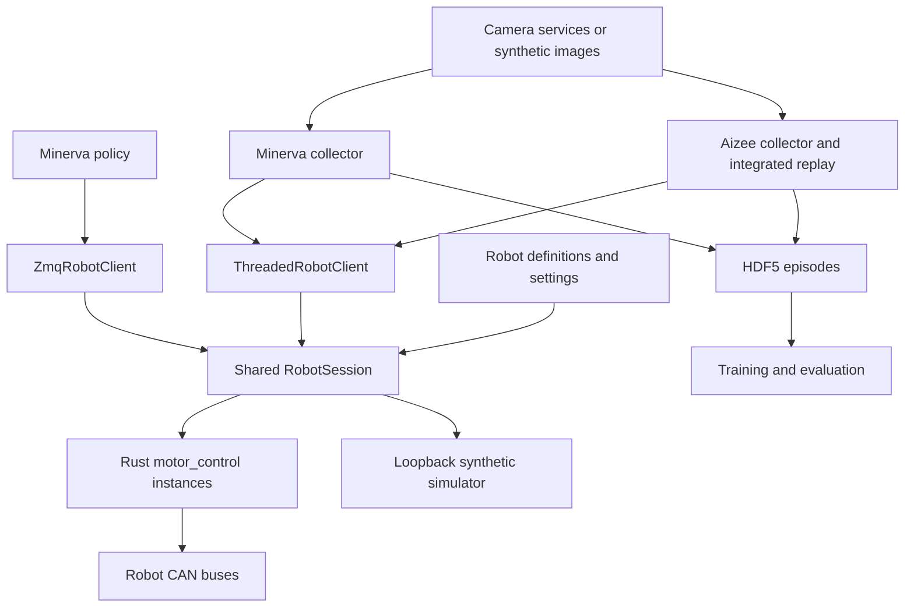

# Aizee / Minerva repository map

Updated 2026-09-24 after the guarded controller core and native fault harness work.
The [generated inventory](REPOSITORY_INVENTORY.md) enumerates tracked files;
the [implementation guide](MONOREPO_IMPLEMENTATION.md) explains installation.

Shared guarded teleoperation now lives in `src/robot_platform/teleop/` (OpenRB
input/bridge, profile-driven mapping and collision supervisor), with the envelope
compiler in `control/collision_envelope.py` and receiver enforcement in
`rust/control_core/src/collision.rs`. Mechanical-reference maintenance is in
`control/mechanical_zero.py`; the physical adapter startup gate is in
`rust/control_core/src/reference.rs`. See [current status](../GUARDED_TELEOP.md).

## Runtime



The same Rust motor binary serves Aizee's bus or either Minerva arm. Minerva
uses one process per arm. Motor commands are MessagePack over ZMQ PUSH/PULL;
telemetry is MessagePack PUB/SUB; cameras use multipart headers and image bytes.
The current simulator substitutes a synthetic server for the controller/motor
path. It does not yet execute the production Rust/CAN controller or load CAD geometry.
A separate [guarded native harness](GUARDED_CONTROLLER.md) now runs the new Rust
control core with an ideal hardware adapter and the existing Python session.
The `guarded_controller` entry point also runs the core through SocketCAN and
acknowledged ZMQ on loopback port 5590. It has passed virtual-CAN tests on Minerva;
physical network movement remains blocked during commissioning. The adapter now
requires fresh watchdog verification before physical enable. The separate finite
trial tool has passed four small right-gripper trials with damped stops. Manual
caliper/encoder pairs provide a coarse unloaded aperture estimate; powered jaw
accuracy and CAD mapping remain open. See [powered commissioning](../POWERED_COMMISSIONING.md).

| Deployment | CAN bus | Command / telemetry | Cameras |
|---|---|---|---|
| Aizee | `can1` | `5555 / 5556` | Gripper 5563, optional scene 5564 |
| Minerva left | `canL` | `5555 / 5556` | Left wrist 5563 |
| Minerva right | `canR` | `5575 / 5576` | Right wrist 5565 |
| Minerva head/scene | — | — | 5564 |
| Simulation | None | Allocated loopback ports | Allocated loopback ports |

Generated simulation settings contain the actual bound ports. Aizee and
Minerva physical services share ports, so deployment on one host selects one
robot. Head/lift slots are inactive and have no shared-session command routes.

## Source ownership

| Location | Responsibility |
|---|---|
| `pyproject.toml` | One Python distribution, extras, CLI, default test selection |
| `Cargo.toml`, `Cargo.lock`, `.cargo/` | One five-crate Rust workspace; output under `rust/target` |
| `src/robot_platform/robots/` | Canonical robot joint order, groups, camera roles, capabilities |
| `src/robot_platform/settings/` | Defaults, layered JSON overrides, endpoint/config validation |
| `src/robot_platform/control/` | Routing, freshness, leases, guarded commissioning transport, offline transmission calibration, software stop and opt-in simulation collision gate |
| `src/robot_platform/transport/` | Shared wire envelopes and discovery |
| `src/robot_platform/data/` | Aizee/Minerva HDF5 writers, synthetic provenance, event traces |
| `src/robot_platform/apps/` | Validated collection/training launch plans and compatibility execution |
| `src/robot_platform/simulation/` | Synthetic plant/loopback, model audit, limit sweeps, FCL CAD queries and native keep-out adapter |
| `src/robot_platform/models/`, `viewer/` | Robot-independent mechanical profiles, shared URDF viewer/jogging, model catalog and pose files; same profiles feed audit/collision |
| `src/robot_platform/characterization/` | Manual/protocol audit and verified bench-profile requirements |
| `rust/comms/` | Shared wire schemas and ZMQ primitives |
| `rust/control_core/` | Guarded ownership/expiry, mandatory watchdog startup, CAN adapter, local stopping, Linux commissioning, finite gripper trials and native harness |
| `rust/motor_control/` | ROBSTRIDE codec, CAN lifecycle, controller/watchdog, raw trace hooks |
| `rust/lidar_control/` | Optional LiDAR service |
| `rust/collision/` | Persistent Parry f64 hierarchy, enclosing distances and explicit link exclusions; C ABI 3 |
| `python/scripts/collect_*` | Active collector loops, robot-specific UI/workflows, calibration adapters |
| `python/common/` | Compatibility imports plus robot-specific gains/helpers still being migrated |
| `python/control/`, `python/ik/` | Gravity fitting/models, Aizee URDF/IK/collision tools |
| `python/teleop/`, `python/web/` | Leader drivers, standalone teleop, Quest/WebXR interface |
| `python/training/` | ACT/JEPA/flow models, datasets, training, inference, analysis |
| `python/nodes/`, `python/tools/` | Camera/power/display services, policy nodes, host dashboard/checks |
| `python/scripts/actuator_char/` | Bench acquisition and analysis behind the characterization CLI |
| `settings/examples/`, `config/` | Operator overlays, hardware profiles, calibration, service definitions |
| `scripts/` | Build, deploy, maintenance, inventory and live validation runners |
| `firmware/` | Embedded projects; OpenRB vendor BSP is required by its build |
| `urdf/aizee/`, `urdf/minerva/` | Mechanical profiles and enclosing artifacts; Minerva uses composed 1.1 visuals / 1.2 collision CAD, preserving raw imports and provenance |
| `docs/devices/` | Identified development Jetson, permanent MACs, provisioning/update log and benchmark evidence |
| `tests/`, `python/tests/` | Offline unit/contract tests and optional GUI/ML checks |

## What has been consolidated

- Both collectors and Minerva inference use the shared session backend.
- Legacy `common.wire` forwards to the package. HDF5 writers and discovery are
  shared; Minerva no longer depends on Aizee's writer or private discovery helper.
- Unused pre-session telemetry receivers and Minerva command/telemetry helpers
  were removed. Their coverage lives in the session and live-process suites.
- The unused PyO3 placeholder was removed; ZMQ remains the Python/Rust boundary.
- Python extras replace the old workstation/training requirements files.
  `requirements_jetson.txt` retains device-specific installation constraints.

## Remaining boundaries

1. Standalone Aizee inference/replay and selected diagnostic tools still own
   their older transports. Their existence as CLIs does not imply dead code.
2. Collector UI, acquisition, learning and device modules still require a
   checkout. Move these only after separating their assets and import contracts.
3. Gains, calibration, camera sizing and GUI preferences remain split between
   application code and config files. See [config ownership](../../config/README.md).
4. The production-controller simulation tier, measured actuator profiles and
   coupled CAD model remain planned work. See [validation plan](SIMULATION_VALIDATION_PLAN.md).
5. CAD and keep-out are explicit geometry policies. The 25 Hz Jetson replay
   covers inter-arm motion with fingers omitted. Unapproved assembly contacts,
   receiver-side expiry and measured stopping still block hardware enforcement.
   See [collision status](COLLISION_RUNTIME_IMPLEMENTATION.md).

## Local artifacts

`episodes/`, `checkpoints/`, `simulation_runs/`, `calibration_runs/`, `phase0_runs/`, `logs/`, `viz/`, `dist/` and
build caches are ignored runtime outputs. The old checkpoints and their plots
were removed on request; recorded episodes and simulation evidence remain.
New training/analysis runs recreate their output directories.

Regenerate the inventory after staging additions/removals:

```sh
python scripts/repo_inventory.py
```

It uses tracked working-tree paths and static Python import candidates, including
the `src/` package root. It does not prove runtime reachability or resolve
dynamic imports, shell/config references, or physical deployment state.
