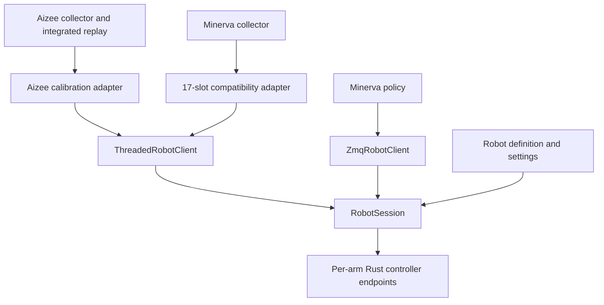

# Legacy applications on the shared session backend

The Aizee collector, Minerva collector and Minerva policy node now use
`robot_platform.control` for arm routing and telemetry freshness. Robot-specific
calibration, gains, UI and control states remain in the application adapters.



## Responsibilities

| Component | Responsibility |
|---|---|
| `RobotSession` | Canonical joint order, endpoint routing, numeric validation, monotonic telemetry age and validity masks |
| `ZmqRobotClient` | Explicit connect/poll/send/close, including receive-only policy dry runs |
| `ThreadedRobotClient` | One thread owns command and telemetry sockets; queued service commands, latest motion and optional target resends |
| Aizee adapter | Motor/URDF sign conversion, leader tracking, limits, state transitions and display cache compatibility |
| Minerva adapter | Legacy 17-slot arrays, healthy-arm operation, temperature/battery/e-stop access and enable/disable/zero fanout |
| Minerva policy | Model input preparation, camera freshness, prediction limits and strict two-arm readiness |

## Motion and telemetry contracts

- A session starts without telemetry or motor commands. Explicit connection does
  not enable motors. Closing transport does not invent a disable command;
  application shutdown remains responsible for sending it.
- Telemetry is the Rust `motors` map keyed by joint name. Receive timestamps use
  the local monotonic clock. Missing, malformed or stale readings are invalid,
  never measured zeros.
- Both collectors apply `control.stale_after_s` from the launcher's resolved
  settings. The session worker checks freshness at transmission, including each
  resend. A stale Minerva arm does not prevent a healthy arm from operating.
- Position readiness and torque completeness are separate. Collection can
  control a position-complete arm whose torque reading is missing; observations
  preserve the missing torque as NaN.
- The Minerva model interface retains its historical 17 slots. Only the 14 arm
  and gripper slots have hardware routes. Reserved head/lift display and model
  inputs may be zero-filled at the legacy boundary; they are not measurements.
- Aizee's tracking calculation still runs at 100 Hz and applies its calibration
  once before submission. Clearing its command holder also clears unsent motion;
  a calculation from a previous mode cannot repopulate that queue. Hardware
  e-stop stops the background command producer as well as the main loop.
- Disable and emergency-stop commands discard pending arm motion. Explicit
  enable is needed before that motion resumes. Service-command delivery is
  unacknowledged by the existing wire protocol: successful local submission is
  not proof that a robot received a command.

## Operator usage

The existing entry points still work. To use a common settings profile:

```bash
robot-platform run collect --robot aizee --settings settings/examples/usb-tether.json
robot-platform run collect --robot minerva --settings settings/examples/usb-tether.json
```

Minerva inference also accepts shared settings directly; inspect
`python python/nodes/minerva_policy_node.py --help` for policy-specific options.
Its `--dry-run` opens telemetry/camera receivers without command sockets.

## Verification and boundaries

The default offline suite includes fake-transport lifecycle/routing tests,
collector adapters, calibration, invalid telemetry, command clearing and mocked
Minerva policy execution. A real ZMQ test uses only in-process endpoints; it
checks the calibrated Aizee payload and expiry at the actual send boundary.
No test enables a physical robot. Run from the
repository root after installing the package:

```bash
python -m pytest
```

The initial session migration passed **206 offline tests**, including selected existing
recording/settings/segmentation regressions. Both collector launchers and the
Minerva policy `--help` entry points loaded successfully. The rebuilt wheel
loads definitions, settings and all shared client classes in an isolated
interpreter without NumPy, Torch, Qt or ZMQ imports during offline construction.

The same work also produced locally cross-compiled `motor_control` and
`lidar_control` ARM64 Linux binaries; see the [Rust guide](../../rust/README.md).

The subsequent simulation stage passed 248 regressions and 12 live scenarios;
see [current validation](SIMULATION_IMPLEMENTATION.md). Superseded Minerva
command/telemetry helpers were removed during cleanup; the shared-session
contract tests cover that path.

This stage migrates the active collector transports and Minerva inference.
Standalone `act_policy_node.py`, `episode_replay_live.py` and older diagnostic
scripts still have their historical transport code. Collector UI/acquisition
modules still live under `python/` and require an editable checkout. Gains,
calibrated limits and camera dimensions are not yet unified into the packaged
settings schema. Hardware timing, CAN behavior and motion need validation on the
dedicated edge device after provisioning.
