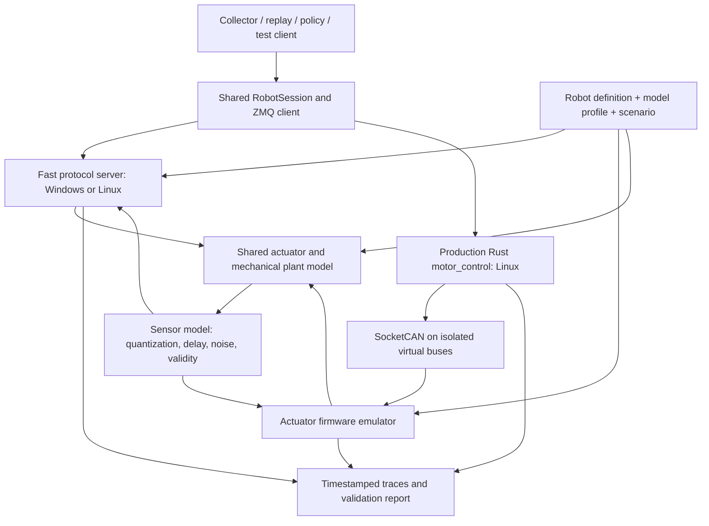

# Shared robot simulation and hardware validation plan

Status: **implementation in progress**, 2026-09-17. The first M0/M1 software slice
and Rust measurement hooks are implemented. See the
[implementation, launch commands, gap disposition, and evidence](SIMULATION_IMPLEMENTATION.md).
Later milestones and hardware acceptance gates below remain requirements.

## 1. Decisions and intended outcome

Build one simulation and measurement framework inside the existing Python
package and Rust workspace. Aizee and Minerva select robot definitions,
deployment settings, actuator profiles, and scenarios. Applications continue
using the shared session and existing wire protocols.

**Minerva is the first hardware calibration target.** The new Orin Nano starts
as a development/simulation device; Minerva's existing compute unit remains the
source of real robot measurements. The first measurement stage uses
**motor-reported torque**, per the user's preference. Independent output torque
and angle measurements are a later stage.

The useful outcome is a repeatable answer to three separate questions:

1. Does the application/controller stack behave correctly, including failures?
2. Does the model reproduce measured motion, reported torque, and response timing
   within a stated operating range?
3. Which physical quantities have actually been checked with independent sensors?

Each released model carries its evidence and limits. A successful software test
does not establish physical accuracy. Agreement with motor-reported torque does
not establish absolute output torque accuracy.

### Evidence labels

| Label | Required evidence | Appropriate use |
| --- | --- | --- |
| `synthetic` | Explicit assumed parameters and passing numerical tests | Application development and fault scenarios |
| `telemetry-calibrated` | Fitted on recorded robot runs; passes separate held-out runs | Motion/timing/reported-torque prediction in the tested envelope |
| `externally-validated` | Independent calibrated measurements also pass | Claims about output torque, angle, backlash, or compliance, only for the measured channels |

Record status **per joint, measurement channel, and operating envelope**. For
example, an arm can have calibrated timing and synthetic thermal behavior.
Extrapolation is flagged; missing evidence never becomes a passing result.

## 2. Repository findings that shape the work

| Existing component | Reuse / required work |
| --- | --- |
| [Robot definitions](../../src/robot_platform/robots/definitions/) and [settings](../../src/robot_platform/settings/) | Keep joint names, order, groups, camera roles, and endpoint selection authoritative here. Simulation profiles reference this contract. |
| [Shared session](../../src/robot_platform/control/session.py) and [worker](../../src/robot_platform/control/background.py) | Exercise real application boundaries, routing, freshness, command clearing, and transport lifecycle. |
| [Rust controller](../../rust/motor_control/src/main.rs) and [motor state](../../rust/motor_control/src/motor.rs) | Run the production controller in the Linux integration tier. Preserve timeout/hold behavior until a separately tested change is intended. |
| [Rust CAN codec](../../rust/motor_control/src/robstride.rs) and [Python codec](../../python/scripts/actuator_char/robstride_mit.py) | Audit against model/firmware-specific documentation and captured frames; establish common reference fixtures. Agreement between these implementations alone is insufficient validation. |
| [Characterization harness](../../python/scripts/actuator_char/harness.py), [analysis](../../python/scripts/actuator_char/analysis.py), and [CLI](../../python/scripts/characterize_actuator.py) | Extend and migrate reusable parts into the package; retain compatibility entry points. Audit existing assumptions before running on hardware. |
| [Existing characterization tests](../../tests/direct_can/test_actuator_char.py) | Bring applicable offline cases into normal discovery. Extend tests to irregular sampling, missing samples, wrong motor IDs, and incomplete responses. |
| [Minerva gravity model](../../python/control/minerva_gravity.py) and [fit](../../config/minerva_gravity.json) | Use as a prior for the poses covered by its data, not as a validated full-arm dynamics model. |
| [Aizee URDF](../../urdf/aizee/aizee.urdf) | Starting geometry/inertia asset to audit. No Minerva URDF is currently present under `urdf/`. |

Specific gaps to resolve:

- Minerva YAML currently requests **400 Hz arm control**, **50 Hz telemetry**,
  and a **0.5 s command watchdog**. These are configured rates, not measured
  performance. The separate CAN feedback timeout in Rust is currently 2 s.
- A 50 Hz publication is one sample every 20 ms. It cannot by itself resolve
  millisecond actuator latency. Repeating cached feedback at a faster logging
  rate does not create additional measurements.
- Rust republishes cached motor feedback with a new message timestamp but no
  per-motor feedback age. The shared session currently measures arrival freshness.
  A live publisher can therefore conceal old CAN measurements. This needs an
  explicit regression test and source-age metadata, not a simulator workaround.
- The existing bench CSV has a loop timestamp and held feedback values; it lacks
  per-frame receive times, sample identity, independent torque, and robust stream
  provenance. The external encoder interface likewise returns a value without
  a device timestamp or sample identity.
- Some existing codec comments assume an encoder reference frame and flag RS00
  torque scaling for verification. Confirm position/velocity/torque units, shaft
  reference, model, and firmware before interpreting physical parameters.
- Minerva hardware files mark the shoulder model as assumed and their position
  limits as placeholders. The calibration snapshot includes directional bounds
  that are not always numerically ordered. Resolve their meaning and approved
  limits explicitly; do not copy them blindly into a dynamics or test profile.
- The deployed e-stop bridge example targets only `5555`; Minerva's right arm
  uses `5575`. Dual-arm stop coverage is a prerequisite for powered dual-arm tests.

## 3. Architecture: two execution paths, shared models and scenarios



### A. Fast protocol simulation

Run on Windows and Linux, initially headless and CPU-only. Speak the actual
MessagePack/ZMQ protocol and expected camera framing so existing applications
can launch against generated settings.

Provide a small, explicit approximation of controller states for fast tests.
It is not authoritative for Rust controller semantics. Shared scenario results
are compared with the real-controller tier to catch behavioral drift.

Use the same plant, sensor models, actuator parameters, scenario format, and
trace format as the Linux tier. The transport adapter is different; the fitted
physical model is not duplicated.

### B. Production-controller simulation

Run one actual `motor_control` process for Aizee and two for Minerva. Each process
gets generated hardware YAML referencing isolated `vcan` interfaces. Minerva's
repeated CAN IDs remain isolated on separate virtual buses.

The emulator implements the actuator-facing protocol: control, enable/disable,
mode and error feedback, required parameter reads/writes, and startup/recovery
exchanges observed in the real controller. Persistent calibration commands only
change sandbox state. Unsupported protocol behavior produces a clear failure.

The controller retains command routing, watchdogs, gain defaults, and recovery
decisions. The emulator supplies actuator/firmware behavior and motion. Avoid
reimplementing the Rust controller's control law or watchdog in this path.

Linux `vcan` provides CAN-frame exchange without physical CAN hardware
([kernel documentation](https://docs.kernel.org/networking/can.html#the-virtual-can-driver-vcan)).
Treat it as a protocol integration tool. Physical arbitration, bus saturation,
USB adapter timing, bus-off behavior, and hardware timestamps require explicit
models and later measurements. Do not infer real bus capacity from `vcan` results.

Start with nominal delivery and measured delay distributions. Add a bounded
bus-delivery model as evidence requires it. Driver write errors and USB reset
failures need an injectable I/O/recovery boundary; delaying emulator responses
alone cannot exercise all those paths. Extract that boundary from Rust with
production behavior preserved. Simulation recovery must never invoke physical
USB reset helpers or change unrelated interfaces.

### Clock modes

- **Deterministic mode:** an injected clock advances the pure model and event
  scheduler; seeded noise and saved state make scenarios repeatable. It can run
  faster than real time without sockets or production process deadlines.
- **Live process mode:** the real applications and Rust processes use wall-time
  scheduling and monotonic clocks. Record deadline misses and achieved rates.
  Do not promise exact determinism or accelerated production-controller execution.
- Pin numerical engine/settings and record platform. Require numerical tolerance
  across Windows/ARM64, not universal byte-identical floating-point trajectories.

### Mechanical models

Begin with a transparent per-joint model: inertia, bounded actuator response,
gravity/load term, friction, limits, and optional compliance/backlash. It supports
isolated actuator fitting and application tests without requiring perfect CAD.

Use **MuJoCo as the proposed coupled rigid-body engine** once link geometry,
joint axes, mass/inertia, and frames have been audited. Its actuator and dynamics
interfaces support this separation ([actuation model](https://mujoco.readthedocs.io/en/stable/computation/index.html#actuation-model)).
Keep the measured actuator response layer ahead of applied generalized torque;
avoid adding a second ideal position servo in the engine. Count friction and
gravity once. Validate the chosen engine version and headless performance on
Windows and the Orin before pinning the dependency.

Independent joint models can validate a bench envelope; they cannot establish
whole-arm coupling, collision behavior, or contact-rich task success. Those
claims wait for the coupled model and corresponding experiments.

## 4. Actuator model contract

Separate the following values throughout traces and reports:

| Quantity | Meaning |
| --- | --- |
| `tau_ff_command` | Feedforward component sent in the command; excludes on-motor PD torque |
| `tau_servo_request` | Model's request from position/velocity feedback plus feedforward |
| `tau_applied_model` | Latent simulated actuator torque after modeled response and saturation |
| `tau_reported` | Motor telemetry or the simulated equivalent, with its measurement model |
| `tau_external` | Independently measured output torque; absent/invalid in the initial stage |

A starting model, expressed in a verified joint coordinate system, is:

```text
servo request = Kp * (q_desired - q) + Kd * (v_desired - v) + feedforward
applied torque = identified response(servo request, delay, limits, state)
joint acceleration = mechanics(applied torque, gravity, friction, external load)
reported torque = identified observation model(applied torque, state) + noise
```

This is a model hypothesis to test. Firmware gain units, saturation ordering,
velocity filters, and what the torque telemetry represents must be verified.
Do not call feedforward torque the total commanded motor effort.

Each actuator profile stores:

- Robot/joint assignment, model and hardware identity, firmware when available,
  sign, zero, gear/shaft conversion, and unit provenance.
- Transport delay/jitter separately from actuator response lag; quantization,
  sample/update rates, filtering, missing-sample behavior, and reporting bias.
- Gain interpretation, torque/current/velocity limits, enable transitions,
  firmware watchdog, fault/reset behavior, and command latching.
- Effective inertia, friction, load dependence, compliance/backlash only where
  identified; thermal/voltage effects initially marked uncalibrated.
- Fit uncertainty, parameter bounds, raw-run IDs, fit/validation split, model
  version, and the valid pose/speed/load/gain/temperature/voltage envelope.

Start from model-family priors but keep per-actuator residuals. Left and right
arms are not assumed identical. Freeze poorly identified parameters instead of
fitting many compensating terms. Without an independent torque/load reference,
torque scale, inertia, and friction can be confounded: report effective parameters
and do not claim a separately measured torque constant or true inertia.

Minerva's first profile has 14 active arm/gripper joints. The three reserved
head/lift slots remain inactive. Grippers retain the existing motor-radian
representation; opening distance/force conversions need later calibration.
Aizee arm and base use distinct dynamics; wheel/ground contact accuracy is a
separate validation track.

## 5. Measurement and trace design comes first

### Capture once at the source

Add opt-in, buffered tracing at these boundaries:

1. Application target creation and shared-client enqueue/send.
2. Rust command receipt and controller acceptance/rejection.
3. CAN write submission and CAN feedback receipt/decoding, per bus and motor.
4. Rust telemetry publication and application receipt.
5. External instrument sampling when available.

Use a monotonic clock for durations on each host. Include host/boot/session ID,
clock domain, event sequence, motor/bus identity, timestamp provenance, and
UTC only for run indexing. A socket write timestamp is **submission time**, not
proof of on-wire transmission or actuator receipt. Record kernel/hardware
timestamps when supported and identify their clock domains and uncertainty.

For multiple hosts, synchronize and estimate offset/drift with uncertainty.
Do not subtract raw monotonic clocks from different hosts or report precise
one-way network latency from ordinary wall-clock timestamps. Initially measure
actuator response locally on Minerva's host and network round trips separately.

Capture every newly received CAN sample available; record original timestamp,
sample sequence, and raw bytes. Do not upsample held values and treat them as
new feedback. Log all joints during a test, not only the excited joint.
Measure tracing overhead, buffer overflow, dropped events, and sustained rates.
The control loop never blocks on disk writes.

### Correct freshness at the source

Plan an additive, versioned telemetry extension for per-motor sample sequence,
age at publication, measurement validity/provenance, and producer epoch.
Source age plus local time since receipt is a useful age bound, but does not
include unknown network transit; network delay must be accounted for separately.
Repeated sequences and producer restarts have explicit handling.

Keep historical parsing compatible, but report legacy source freshness as
unknown. Validation scenarios require the richer metadata. Synthetic enable
feedback must be marked synthetic, and must not count as a new physical sample.
Implement source-freshness gating as an intentional tested behavior change in
both Rust/Python boundaries, with fixtures for mixed versions.

### Run artifact

Use a versioned manifest plus lossless HDF5 event/sample streams, building on the
existing package's data dependencies. Include raw CAN and command payloads;
keep asynchronously sampled streams separate until analysis. Export CSV for
inspection. Avoid forcing bench data into the legacy episode schema.

The manifest contains source revision **and dirty-source hash**, Rust binary
hashes, dependency/toolchain versions, resolved robot/settings/profile hashes,
calibration IDs, machine/adapter identity, firmware, power/thermal conditions,
scenario/seed, instruments, clock quality, and explicit missing information.

Store approved small fixtures and profile/report manifests in version control.
Keep large immutable raw runs in an artifact store or designated data directory,
referenced by checksums. Store simulator traces and training episodes separately;
synthetic episodes carry provenance and are not silently added to real datasets.

## 6. Real-world characterization campaign

### Stage A: passive inventory and baseline

- Confirm actual actuator models/firmware/CAN IDs, signs, joint coordinates,
  usable bounds, gains, and configuration currently running on Minerva.
- Record disabled/stationary and existing normal-operation traces on the
  current compute unit. Establish feedback rate, gaps, noise/quantization,
  enable timing, network delay, and controller scheduling under representative
  camera/CPU load.
- Resolve protocol scale/reference ambiguities before fitting physical units.
  Preserve raw frames so a corrected decoder can reprocess old captures.

Deliverable: hardware inventory, baseline traces, data-quality report, and
approved per-joint test envelopes. No arbitrary sweep amplitudes are inherited
from old bench script examples.

### Stage B: bounded joint response using motor telemetry

Start with one accessible joint under a supported load, then representative
actuators from each installed model, and finally both arms' individual joints.
Hold other joints in documented poses and record their state. Characterization
has one command owner; do not run a direct-CAN bench writer alongside the Rust
controller on the same motors.

Use a shared trajectory specification for simulation and hardware, with:

1. Stationary holds and small positive/negative, slew-limited steps for delay,
   rise time, overshoot, settling, and bias.
2. Slow bidirectional sweeps at several speeds for friction/load asymmetry.
3. Limited-frequency chirps or multisines inside the measured bandwidth and
   sampling limits, to separate lag from pure delay.
4. Repeated runs at selected gains, poses, and known payload configurations.
5. Separate repetitions after warm-up and under representative compute/bus load.

Use at least five repetitions for initial repeatability estimates; collect more
where confidence intervals are too wide. Exact amplitudes, frequencies, gains,
durations, and abort limits are fixed after Stage A. Start trajectories at the
measured pose, not assumed zero. Limits, feedback loss, and stop behavior belong
to the hardware runner as well as the test specification. Support the arm where
loss of drive torque would otherwise let it fall.

This stage validates motion in the reported coordinate system and torque
**telemetry behavior**. It does not independently validate absolute output
torque, gearbox backlash, or torque constant. Existing gravity fits can help
choose tests, but training-fit scores are not held-out physical validation.

### Stage C: whole-arm validation

Validate unseen multi-joint trajectories and poses with different payloads and
both arms active. Repeat with camera streams and representative host load.
Use forward simulation from the initial state for the entire held-out trajectory;
do not reset the model to measured state every sample and call that prediction.

Compare both open-loop command replay (same recorded commands applied to the
model) and closed-loop application scenarios. They answer different questions:
model fidelity versus system behavior when simulated observations change commands.

### Stage D: independent instruments, later

Add calibrated output torque/load measurement and an independently timestamped
output encoder. A lever/load-cell fixture needs known geometry, gravity/tare
correction, and an uncertainty budget. Static torque checks do not validate
dynamic torque; dynamic claims also require adequate instrument bandwidth and
synchronization. Add current measurement before claiming an identified torque
constant, if the drive does not expose a validated current channel.

Revisit scale/bias, direction dependence, compliance, backlash, and effective
mechanical parameters. Promote only the independently checked channels and
operating envelope to `externally-validated`.

## 7. Validation rules and acceptance gates

### Separate fitting from testing

Split by entire run/session and conditions, not random neighboring samples.
Keep a fit set, a development-validation set, and a frozen final holdout with
unseen trajectories/poses and a separate recording session. Choose and freeze
acceptance limits before examining that final holdout. A failed holdout remains
a recorded failure; once used for tuning it is no longer an untouched holdout.

Compare against a simple baseline model. Additional model complexity must improve
held-out prediction or explain an independently observed effect. Inspect residual
errors versus direction, speed, pose, temperature, and load. Preserve systematic
errors; do not hide them with unrestricted time warping or arbitrary trace shifts.

### Proposed first accuracy targets

These are engineering targets to refine after the initial measurement-quality
study, **not measured performance or actuator specifications**. Freeze actual
per-joint limits before the final validation campaign.

| Measure | Initial target / reporting rule |
| --- | --- |
| Position tracking | RMSE <= 5% of the prescribed test excursion; peak error <= 10%; also publish radians and any task-specific tighter limit |
| Rise/settling time | Within 15% of repeated measured values; detect never-settled or censored runs rather than assigning a finite success |
| Response delay | Error <= max(2 ms, 20% of measured delay), only when timestamp/sample uncertainty supports this comparison |
| Overshoot | Within 5 percentage points of measured step excursion |
| Reported torque | RMSE <= 10% of the predefined usable torque span for that test; publish bias and absolute error per joint; use an absolute tolerance for near-constant signals |
| Frequency response | Proposed +/-3 dB magnitude and +/-15 degrees phase over the declared, adequately excited and sampled band |
| Robustness | All required routing/freshness/state-machine scenarios pass; no averaging away a failed joint or hazardous transition |

Report confidence intervals and repeatability separately from model error. If
measurement uncertainty exceeds the target, label the result inconclusive and
improve measurement or narrow the claim. Do not silently relax the target to
match noisy instruments. Initial motor-telemetry-only torque scores never count
as an independent newton-metre accuracy claim.

### Required fault and lifecycle scenarios

- No commands on construction/connect; correct joint signs and one-time
  coordinate conversion; no left/right cross-routing despite repeated CAN IDs.
- Missing, malformed, late, repeated, out-of-order, and frozen motor feedback,
  including one frozen motor while the telemetry publisher stays alive.
- One Minerva arm lost: collector behavior remains per-arm; policy behavior
  remains strict across both arms. Reserved head/lift commands are rejected.
- Disabled motor, enable failure, fault latch/clear, reconnect, controller
  restart, partial command delivery, bounded backpressure, and shutdown.
- Pending motion around disable/e-stop/mode changes cannot reappear. Distinguish
  command timeout hold, disable, and emergency stop by actual controller output.
- Application producer stalls while telemetry remains healthy: specify a finite
  target lease and explicit renewal semantics before implementing this scenario's
  acceptance rule. Fresh telemetry alone is not evidence that the producer lives.
- Camera outage/frozen frame/late inference result prevents use of stale policy
  actions. Missing torque remains missing; it is not filled with zero.
- Recording can be reopened by the real dataset reader; timing/order/units and
  synthetic provenance survive. No accidental writes to real episode directories.
- A 60-minute live-process soak with both arms and representative camera traffic:
  no unexplained deadlocks, queue growth, or lost stop transitions; report achieved
  rates, p50/p95/p99 delays, gaps, memory trend, and trace drops. Freeze numerical
  load/performance budgets after the Jetson baseline.

Some cases are expected to expose current implementation gaps, particularly
source freshness and producer leases. Record and fix those through explicit
production changes; do not teach the emulator to hide them.

### Numerical checks

Check units, torque directions, energy/damping behavior, saturation, static
equilibrium, and state transitions on small analytical cases. Halve the physics
time step and increase solver accuracy until relevant metrics converge within
the allocated numerical-error budget. Save full state needed for replay, including
delay buffers, noise state, and engine integration state
([MuJoCo simulation state](https://mujoco.readthedocs.io/en/stable/programming/simulation.html#state)).

## 8. Cameras, grippers, base, and task simulation

- **First application tests:** deterministic synthetic camera frames carrying
  frame identity/time, with the actual dimensions/encoding/wire contract. Add
  drop/freeze/delay controls and recorded-stream replay. These test plumbing,
  recording, and freshness; they do not establish visual-policy transfer.
- **First actuator tests:** all active arm/gripper joints, with gripper contact
  forces explicitly unvalidated until measured. Model firmware limits and state
  transitions before adding elaborate contacts.
- **Coupled stage:** audited Minerva geometry, collision shapes, masses, joint
  frames, then camera extrinsics and simple object contacts. Validate static
  poses and free-space movement before grasping/collision claims.
- **Aizee extension:** same protocol/scenario framework from the first software
  milestone; separately calibrate its arm, wheel dynamics, floor friction, and
  drive-stop behavior. Add synthetic LiDAR protocol tests before any claim about
  real scan/scene fidelity.
- **Later policy work:** visual fidelity, contact validation, task success, and
  measured parameter variation. Sample uncertainty within supported ranges;
  broad randomization is not a substitute for a calibrated mean model.

## 9. Planned repository placement and user workflow

Create modules as their milestones land; retain one Python distribution and one
Cargo workspace. Do not combine this work with the larger planned folder move.

```text
src/robot_platform/
  simulation/             # clock, plant, firmware emulator, ZMQ/vcan adapters
    profiles/             # versioned small model profiles, referencing RobotSpec
    scenarios/            # reusable trajectories and fault schedules
    models/               # audited mechanical assets when available
  characterization/       # acquisition, instrument adapters, fit, validation
  data/traces/            # versioned trace/manifest readers and writers
  apps/                   # sim / characterize / validate CLI adapters
rust/motor_control/       # measurement hooks + narrow injectable I/O boundary
tests/
  unit/                   # model/clock/measurement-analysis tests
  contract/               # Rust/Python/CAN fixtures and both robot definitions
  simulation/             # process tests with explicit environment selection
  fixtures/simulation/    # small captures, golden scenarios, reference reports
docs/architecture/
  SIMULATION_VALIDATION_PLAN.md
```

Proposed commands below are a CLI design, **not currently implemented**:

```text
robot-platform sim run --robot minerva --tier protocol --scenario nominal
robot-platform sim run --robot minerva --tier controller --scenario feedback-loss
robot-platform sim validate --profile <profile> --runs <held-out-manifest>
robot-platform characterize plan --robot minerva --joint <joint> --routine step
```

A simulation launch writes a run manifest and resolved application settings
file. The current collector launcher then consumes that settings file. Local
simulation uses loopback endpoints and separate output paths, with explicit
displayed simulation identity. PC-to-Jetson simulation uses an explicit endpoint
overlay. Never fall back through robot network discovery.

The controller tier verifies interface type `vcan`, uses sandbox-generated
configuration, and refuses physical adapters. Provision virtual interfaces
separately; normal simulation does not need elevated access. Hardware
characterization has its own explicit runner/preflight and cannot be reached
by accidentally choosing a simulation profile. Existing Aizee collector
`--dry-run` only changes recording behavior and must not be used as isolation.

Dependency extras keep optional CAN, physics, fitting, and rendering libraries
out of base package imports. CI runs pure/contract cases on Windows and Linux;
the Linux runner provisions `vcan` for controller tests. The dedicated Jetson
adds ARM64 build/runtime and performance checks. Missing `vcan` support is reported
as an unmet tier prerequisite, not a successful integration test.

## 10. Build sequence and deliverables

| Milestone | Deliverable | Exit gate / dependencies |
| --- | --- | --- |
| **M0: contracts and evidence** | Audited protocol/units inventory; reference frame fixtures; scenario and trace schemas; ownership/freshness/lease behavior decisions | Both robot contracts covered; current unknowns explicit; measurement plan reproducible |
| **M1: fast simulator** | Shared plant/sensor core, deterministic clock, protocol server, synthetic cameras, generated settings, scenario runner, reports | Both collectors connect; Minerva recording/dataset round trip; routing/lifecycle/fault tests run without hardware; profiles labeled synthetic |
| **M2: production-controller path** | Virtual-CAN firmware emulator, Rust trace hooks and I/O/recovery boundary, source-freshness change with compatibility tests | Real Rust processes pass shared scenarios on Linux; cross-built and native binaries exercised on the Jetson; differences from fast tier explained |
| **M3: first measured model** | Upgraded characterization runner, passive/active Minerva captures, per-joint fit and validation reports | Held-out motion/timing/reported-torque gates pass inside stated envelopes; unsupported channels remain labeled |
| **M4: coupled robot** | Audited Minerva mechanical model, MuJoCo integration, multi-joint/dual-arm load tests, application soak | Coupled held-out tests pass; live-process timing budget and no unintended resume behavior verified |
| **M5: independent validation and expansion** | Independent torque/angle instrumentation, revised model uncertainty, Aizee physical calibration, contact/vision work as needed | Each new claim has its own evidence and envelope; no automatic transfer of Minerva calibration to Aizee |

**First implementation slice:** M0 followed by M1. M2 measurement hooks can be
built while the Jetson is being provisioned. Passive Minerva capture can begin
once the instrumentation and inventory are ready; it need not wait for a full
3D robot model. M3 fitting depends on actual captures. M4 depends on trustworthy
mechanical geometry and M3 response models. Independent sensors do not block
M0-M4, but their absence limits physical torque/backlash claims.

Every milestone delivers a runnable command, bounded tests, versioned fixtures,
and a machine-readable report plus comparison plots. The simulator is ready for
routine use once M1/M2 pass. It is ready to support calibrated controller tuning
only for profiles/envelopes that pass M3 and, where coupling matters, M4.

## 11. Setup information to collect while development proceeds

From the new Jetson: OS/JetPack release, Python/Rust versions, SSH endpoint,
available `vcan` support, storage, power mode, and cooling configuration.

From Minerva: deployed revision/configuration, actual left/right actuator
inventory and firmware, CAN adapters/buses, gain/limit/calibration files, payload
and link geometry sources, current stop behavior, and a representative set of
normal-operation logs. Existing logs can guide scenarios even if their timing
quality is insufficient for final identification.

These are inputs to verify during setup, not assumptions to invent in the model.

## References

- [Shared session migration and current test scope](SESSION_BACKEND_MIGRATION.md).
- [Implemented monorepo boundaries](MONOREPO_IMPLEMENTATION.md).
- [Linux SocketCAN and virtual CAN](https://docs.kernel.org/networking/can.html).
- [MuJoCo actuation model](https://mujoco.readthedocs.io/en/stable/computation/index.html#actuation-model).
- [MuJoCo model construction and contact/friction parameters](https://mujoco.readthedocs.io/en/stable/modeling.html).
- [MuJoCo simulation and reproducibility](https://mujoco.readthedocs.io/en/stable/programming/simulation.html).

Manufacturer/model/firmware protocol references and captured-frame provenance
will be pinned during M0; existing repository comments are not substitutes for
that audit.
