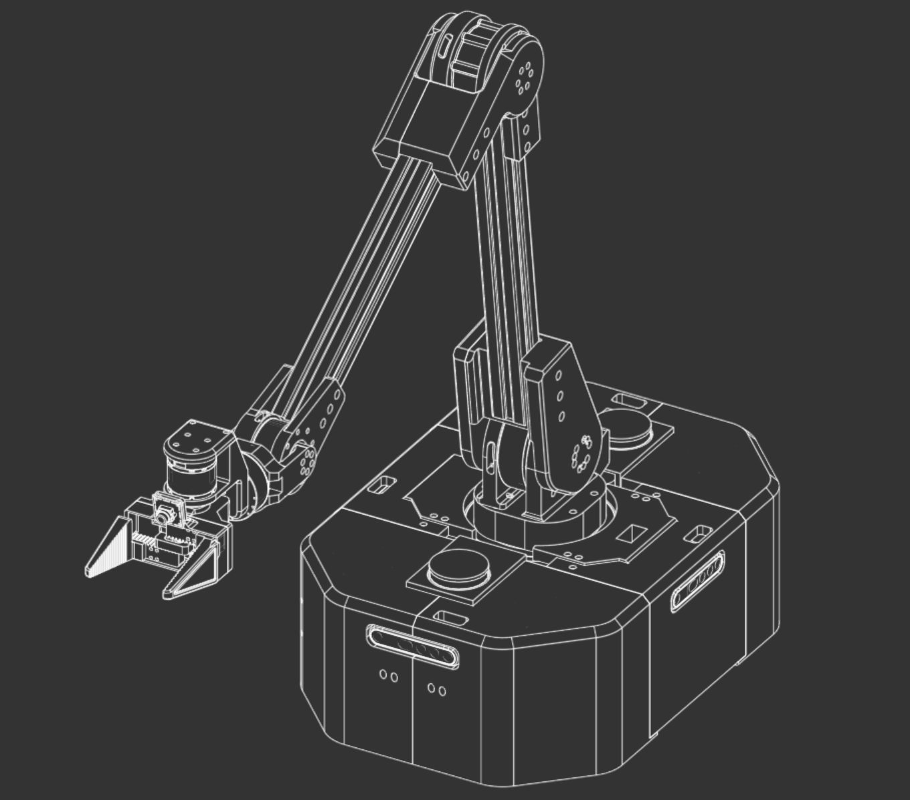

# AIZEE



AIZEE is the single-arm prototype this platform grew from: a swivel, a three-joint gantry, wrist pitch and roll and a
gripper on RobStride motors, with wheel drive, a gripper camera and a RealSense scene camera, on a Jetson. It stays
here as one robot option beside Minerva, and nothing below is needed to run Minerva.

```sh
robot-platform describe --robot aizee
robot-platform view --robot aizee
robot-platform sim run --robot aizee --output simulation_runs/aizee-001
robot-platform run collect --robot aizee --settings settings/examples/usb-tether.json --plan
robot-platform run train --robot aizee --plan
```

`--plan` prints what would start and opens nothing. Its CAD is [in Onshape](https://cad.onshape.com/documents/191b8a861f2900918f30776f/w/8fcf08900b23701d0eff1c6a/e/fcb77dc7adbafb5b753006f3).

## Its guides

| Guide | What it covers |
| --- | --- |
| [Fresh Jetson setup](FRESH_JETSON_SETUP.md) | A development Jetson, then AIZEE's provisioning |
| [Jetson quick start](JETSON_QUICK_START.md) | Connecting, teleop, data collection |
| [After a reboot](QUICK_START_AFTER_REBOOT.md) | Checking the services, troubleshooting |
| [Learning pipeline](LEARNING_PIPELINE.md) | Calibration to deployment with `collect_demo.py` and the ACT trainer |
| [Motors](MOTORS.md), [cameras](CAMERAS.md), [UPS](UPS.md), [LiDAR](LIDAR.md), [Tufty2040 display](TUFTY2040.md) | Its hardware |

They describe AIZEE as it was deployed, and the addresses in them are AIZEE's defaults (`192.168.0.27` on a LAN,
`192.168.50.1` on its access point, `10.42.0.1` over USB-C).

## Which `aizee-*` names belong to AIZEE

Minerva was first brought up on AIZEE's software, on a Jetson set up with AIZEE's scripts. So some things named
`aizee` are only AIZEE's, some are retired, and some are parts Minerva runs today under the old name. This table
sorts them. None was renamed when the repository became `platform`, because a name installed on a robot changes only
with a deployment.

### AIZEE's own

Minerva does not use these. `robots/definitions/aizee.json` and the units below are what selects them.

| Name | What it is | Minerva's relation to it |
| --- | --- | --- |
| `aizee-motor-control-rover` | AIZEE's motor service, `config/hardware_jetson_rover.yaml` | A conflicting service: `scripts/setup_minerva_system.sh` stops and disables it, and the unit's profile lists it |
| `aizee-gripper-cam`, `99-aizee-gripper-cam.rules` | The gripper's UVC camera | Minerva's wrist cameras are `minerva-left-wrist` and `minerva-right-wrist` |
| `aizee-display`, `99-aizee-display.rules` | The Tufty2040 status display | None |
| `aizee-lidar-control`, `99-rplidar.rules` | The RPLiDARs | None |
| `scripts/deploy_jetson_rover.sh`, `deploy_gripper_camera.sh`, `deploy_lidar_control.sh`, `deploy_tufty2040.sh` | AIZEE's deployment | None |

### Retired

Nothing should be running these on any current robot. Each still has references to clean up.

| Name | What it was | Still referenced by |
| --- | --- | --- |
| `aizee-minerva-left`, `aizee-minerva-right` | Minerva's first motor services, through `motor_control` | The unit's profile lists them as conflicting; `python/tools`, scripts |
| `aizee-ups-monitor` | The UPS service | `ops/ups.py` disables it in favour of `minerva-ups` |
| `aizee-ap`, `aizee-poe.conf` | The earlier access point and PoE network | `ops/network.py` treats them as old |
| `aizee-estop-bridge` | The ESP-NOW stop bridge, retired 2026-09-26 | `python/tools/setup_checks.py` |
| `aizee-camera-relay` | An earlier camera relay | Comments in `config/hardware_minerva_right.yaml` and one script |

### Minerva runs these under the old name

Renaming any of these means changing the running robot, so it belongs with a deployment and a live test. Leaving them
breaks nothing.

| Name | What it does on Minerva | A rename would touch |
| --- | --- | --- |
| `aizee-scene-cam`, `/dev/aizee_scene_cam`, `99-aizee-scene-cam.rules` | The head D435's publisher | The unit, the udev rule, `ops/cpu_partition.py`, deploy scripts |
| `aizee-heartbeat` | The dashboard on port 8088, which titles itself Minerva | The unit, its CPU drop-in, deploy scripts |
| `scripts/aizee-can-up`, `aizee-can-reset`, `aizee-reset-usb-can`, `/etc/sudoers.d/aizee-can` | Bringing up and resetting the CAN adapters | Installed helpers and sudoers, the unit's profile, several scripts |
| `AIZEE_SSH_KEY_FILE`, `AIZEE_TARGET` | Environment variables the deploy tools read | `ops/`, scripts, the operator's shell |
| `AIZEE_CONFIG` | The older `motor_control` service's profile | The units that set it, `rust/motor_control` |
| `aizee-rover` | The production Jetson's hostname | The unit's profile, the GELLO bridge's discovery, `ops/network.py`, its certificate |
| `/home/ltr/aizee` | Where the older units expect a checkout | The units and the provenance strings already recorded |
| `AIZEE-OPENRB-LEADER` | The identity the leader firmware reports | Firmware (a reflash), `teleop/openrb.py`, `python/teleop` |
| `AIZEE_SIM`, `~/aizee-sim` | The training server's working folder | `scripts/training_server/`, the server |
